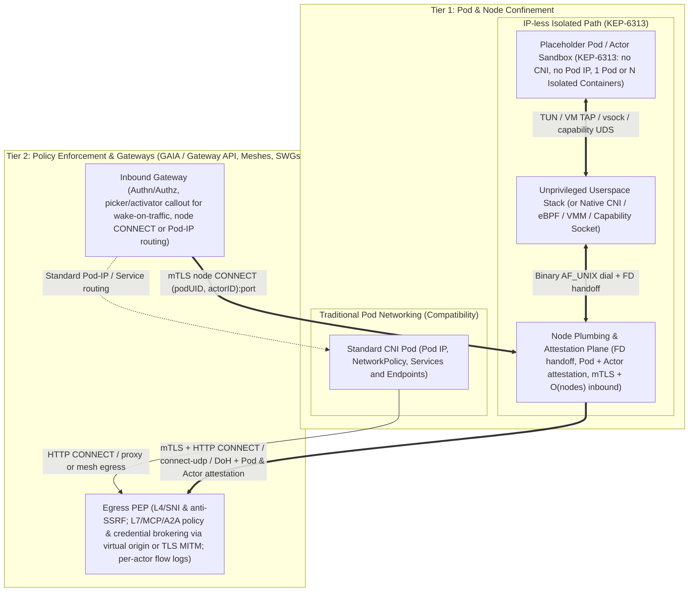

# Kubernetes Networking for the Agentic Era

**Status:** Architecture and Vision Draft  
**Reference Implementation:** [`aojea/agents.net`](https://github.com/aojea/agents.net)  
**Context:** Spin-off of [CNCF Maintainer Summit #126](https://github.com/cncf/maintainer-summit/discussions/126) (*Evolving Kubernetes for Agentic Workloads: Rethinking the Pod and Node Boundary*)

---

## Introduction

Autonomous AI agents do not fit the assumptions behind standard Kubernetes networking. As discussed at [CNCF Maintainer Summit #126](https://github.com/cncf/maintainer-summit/discussions/126), agents sit idle most of the time, wake up in bursts when a user or tool calls them, pack at high density onto nodes, and run untrusted generated code next to sensitive credentials. Because the standard Pod network model gets in the way of those requirements, platforms such as [Agent Substrate](https://github.com/agent-substrate/substrate) and [NVIDIA OpenShell](https://github.com/NVIDIA/OpenShell) build their own networking outside Kubernetes and treat clusters mostly as VM managers. If Kubernetes does not update its Pod and node networking boundaries, low-level agent plumbing will split into incompatible stacks.

This document is the networking companion to the SIG Node Process Layer work (*Kubernetes as the Distributed OS for AI*) coming out of [CNCF Maintainer Summit #126](https://github.com/cncf/maintainer-summit/discussions/126). Resource management, scheduling, storage, and VMM lifecycle stay in SIG Node, SIG Scheduling, and SIG Storage. This document focuses on the Pod/node confinement contract, the distinction between Pod attestation and actor attestation, and the wire boundary between nodes and Policy Enforcement Points (PEPs).

Across container runtimes, microVMs, service meshes, and cloud sandboxes, agent networking has converged on one pattern: remove direct IP routing from the sandbox and funnel traffic through HTTP `CONNECT` proxies (or explicit capability sockets) into Policy Enforcement Points (PEPs). That pattern rests on established standards, from early IETF policy frameworks ([RFC 2753](https://www.rfc-editor.org/info/rfc2753), [RFC 3838](https://www.rfc-editor.org/info/rfc3838/)) and Zero Trust Architecture ([NIST SP 800-207](https://csrc.nist.gov/pubs/sp/800/207/final)), to recent IETF drafts on agent enforcement boundaries ([`draft-liu-audit-enforcement-points-00`](https://www.ietf.org/archive/id/draft-liu-audit-enforcement-points-00.html)), to HTTP/2 tunneling in Envoy and [Istio Ambient HBONE](https://istio.io/latest/docs/ambient/architecture/hbone/) ([RFC 9110](https://www.rfc-editor.org/info/rfc9110), [RFC 9298](https://www.rfc-editor.org/info/rfc9298)). Using standard wire protocols lets Kubernetes define the node boundary once and work with existing service meshes, gateways, and agent platforms.

This work builds on several years of SIG Network changes. After seeing through [Multi-Network (KEP-3698)](https://github.com/kubernetes/enhancements/issues/3698) and [KEP-4410](https://github.com/kubernetes/enhancements/issues/4410) how brittle it is to bend the flat Pod-IP model, SIG Network moved toward small core primitives that external drivers compose:

- At the 2024 Paris Contributor Summit, SIG Network started the Kubernetes Network Driver effort to move past monolithic CNI assumptions and serial CNI chaining ([kubernetes#130594](https://github.com/kubernetes/kubernetes/issues/130594)).
- The [Kubernetes Network Driver (KND) model](https://arxiv.org/abs/2506.23628) and [DRANET](https://github.com/kubernetes-sigs/dranet) showed that Dynamic Resource Allocation (DRA), [KEP-4817](https://github.com/kubernetes/enhancements/issues/4817), and [NRI](https://github.com/containerd/nri) let standalone node drivers attach secondary and hardware network devices without changing the cluster CNI.
- [KEP-6313](https://github.com/kubernetes/enhancements/issues/6313) (merged as Alpha in v1.38 via [kubernetes#143280](https://github.com/kubernetes/kubernetes/pull/143280)) adds `spec.podNetwork: Isolated`, letting a Pod opt out of the default pod network with only a loopback interface, no CNI call, and no Pod IP, failing closed if the runtime does not advertise the CRI `pod_network_isolated` capability.

The goal is the same as with Kubernetes core components like `kube-proxy` and out-of-tree SIG reference projects like `kindnet`, [`kube-network-policies`](https://github.com/kubernetes-sigs/kube-network-policies), and [`DRANET`](https://github.com/kubernetes-sigs/dranet): keep core Kubernetes small, standardize only the right boundaries, and test the design against a working reference implementation ([`aojea/agents.net`](https://github.com/aojea/agents.net)).

---

## 1. Two-Tier Architecture and Ownership Boundaries

Agent networking in Kubernetes splits into two tiers with a standard wire contract between them, matching the split between Host Enforcement Points and Gateway Enforcement Points in [`draft-liu-audit-enforcement-points-00`](https://www.ietf.org/archive/id/draft-liu-audit-enforcement-points-00.html) and [NIST SP 800-207](https://csrc.nist.gov/pubs/sp/800/207/final).

Core Kubernetes does not prescribe a single node datapath. The table below separates what upstream Kubernetes standardizes from what stays in extension APIs, wire conventions, and individual driver implementations.

| Layer | Owner | What Belongs Here |
| --- | --- | --- |
| **Core Kubernetes** | SIG Network, SIG Node, SIG Auth | `Pod.spec.podNetwork: Isolated` (KEP-6313), kubelet probe and DNS rules for IP-less Pods, runtime capability advertisement, CRI/OCI interface FD handoff hooks, and workload-identity primitives. |
| **Extension APIs** | GAIA / Gateway API, SIG Apps | Inference routing (`InferencePool`), access policy (`XAccessPolicy`), external callout/activator boundaries, IP-less backend discovery, and sandbox lifecycle CRDs (`agent-sandbox`). |
| **Inter-Tier Wire Profile** | IETF / Ecosystem convention | Mandatory mTLS, HTTP `CONNECT` (RFC 9110), `connect-udp` (RFC 9298 / HTTP/3 datagrams), DoH (RFC 8484), `Proxy-Status` (RFC 9209), and Pod + Actor attestation encoding. |
| **Node Datapath Implementation** | CNI, runtime, or driver authors | Host userspace network stack, native CNI confinement (OVN-Kubernetes, Cilium, Calico), eBPF socket steering, VMM/DPU proxy, explicit capability sockets, and Virtual DNS. |

### Tier 1: Pod and Node Confinement

Tier 1 owns the node and Pod confinement boundary and supports two paths into Tier 2:

- **IP-less isolated path (target):** Uses [KEP-6313](https://github.com/kubernetes/enhancements/issues/6313) (`spec.podNetwork: Isolated`) with no CNI call and no Pod IP. A Tier 1 provider — whether an unprivileged host-side userspace network stack, a native CNI plugin, an eBPF/DPU dataplane, or an explicit capability socket — confines guest traffic and bridges it to Tier 2 with attested identity.
- **Traditional Pod networking (compatibility):** Clusters that do not need strict confinement can keep running workloads such as [`agent-sandbox`](https://github.com/kubernetes-sigs/agent-sandbox) on existing CNI clusters with Pod IPs, `NetworkPolicy`, Services, and standard proxies, routing into the same Tier 2 PEPs and gateways.

### Tier 2: Policy Enforcement Points and Gateways (GAIA, Meshes, SWGs)

L7 policy, routing, and external gateways live off-host in Tier 2 — implemented by service meshes, cloud Secure Web Gateways (SWGs), and **GAIA** (*Gateway for AI and Agents*, the Gateway API initiative consolidating inference routing from GIE, agentic access policy from `kube-agentic-networking`, and WG AI Gateway). Today, GAIA centers on inference routing (`InferencePool`), identity-aware L7/MCP authorization (`XAccessPolicy`), and external processing callouts. Extending Gateway API to cover forward-proxy egress, DNS/DoH routing, off-sandbox credential brokering, and IP-less inbound backends is a joint design area rather than settled GAIA scope. Keeping policy engines, L7 inspection, and upstream secrets out of Tier 1 lets those APIs evolve in Tier 2 without coupling to node plumbing.

### Wire Contract Between Both Tiers

Tier 1 and Tier 2 communicate over a versioned tunneling profile built on mandatory mTLS and HTTP/2 `CONNECT` ([RFC 9110](https://www.rfc-editor.org/info/rfc9110)), with optional `connect-udp` ([RFC 9298](https://www.rfc-editor.org/info/rfc9298)), DNS over HTTPS ([RFC 8484](https://www.rfc-editor.org/info/rfc8484)), and `Proxy-Status` ([RFC 9209](https://www.rfc-editor.org/info/rfc9209)). For UDP-heavy or QUIC workloads, HTTP/3 transport with native datagrams ([RFC 9297](https://www.rfc-editor.org/info/rfc9297)) is the target path to avoid TCP-over-TCP congestion collapse.

Because raw HTTP `CONNECT` tunnels carry opaque guest TLS ciphertext, the boundary defines two distinct Tier 2 egress modes:

- **L4 / SNI passthrough:** Tier 2 enforces host, port, SNI, and anti-SSRF rules without decrypting guest TLS. No custom CA is needed inside the sandbox, and certificate pinning keeps working, but Tier 2 cannot inspect MCP/A2A payloads or inject HTTP credentials into HTTPS requests.
- **L7 inspection and credential injection:** Enforcing MCP/A2A policy or injecting upstream API keys requires either (a) gateway-owned virtual origins or explicit capability sockets where the sandbox speaks plain HTTP (or a local socket) and Tier 2 originates upstream TLS with no MITM CA, or (b) TLS interception using a custom CA trusted by the sandbox (which requires configuring per-language trust stores, breaks certificate pinning, places a minting CA key inside Tier 2's TCB, and requires blocking or downgrading QUIC on UDP/443 so clients do not bypass TCP inspection).

While this profile shares mTLS HTTP/2 `CONNECT` foundations with Envoy and Istio Ambient HBONE, plain HBONE targets Pod/Service IPs with per-workload SPIFFE SVIDs and forward Pod-IP inbound. It does not natively specify hostname `:authority` egress, DoH, `connect-udp`, `Proxy-Status`, actor-attested identity, or IP-less inbound. Standardizing this delta with GAIA and service mesh communities is an explicit goal rather than assuming drop-in HBONE compatibility today.

---

## 2. Why Traditional Pod Networking Breaks Down for Agents

Standard CNI networking works well for typical services, which is why Tier 1 keeps a compatibility path for it. For dense, multi-tenant, untrusted agents, four problems get in the way:

1. **Host network namespace exposure and kernel blast radius.** Standard `veth` plumbing feeds untrusted workload packets through the host network namespace's routing tables, `conntrack`, `nf_tables`, and CNI eBPF programs. For `runc` containers, removing `veth` isolates the host network namespace while the container still shares the host Linux kernel inside its Pod network namespace. When paired with `gVisor` or KVM microVMs, moving packet parsing to an unprivileged host userspace stack keeps guest TCP/IP traffic off the host kernel datapath completely and lets operators patch stack bugs with a container rollout instead of draining and rebooting nodes — following the control/dataplane split in **Snap** ([Marty et al., SOSP 2019](https://dl.acm.org/doi/10.1145/3341301.3359657)), **Arrakis** ([Peter et al., OSDI 2014](https://www.usenix.org/conference/osdi14/technical-sessions/presentation/peter)), and **IX** ([Belay et al., OSDI 2014](https://www.usenix.org/conference/osdi14/technical-sessions/presentation/belay)).
2. **IP-per-Pod and per-actor API objects limit density and lifecycle speed.** Agent platforms run hundreds of mostly idle sandboxes per node, hold warm pools that bind to users on demand, and suspend or resume actors in under a second ([Agent Substrate](https://github.com/agent-substrate/substrate/blob/main/docs/concepts/architecture.md), [Firecracker, NSDI 2020](https://www.usenix.org/conference/nsdi20/presentation/agache)). Allocating a cluster or VPC IP per sandbox burns IPAM space and churns CNI plugins, eBPF maps, and nftables rules; creating a Pod or `Service` per short-lived actor adds heavy apiserver, etcd, and `EndpointSlice` churn.
3. **IP firewalls and `HTTP_PROXY` do not enforce agent policy.** External APIs, package registries, and model endpoints sit behind shared CDNs with rotating IPs, so IP-based `NetworkPolicy` breaks and allows DNS rebinding. `HTTP_PROXY` is only advisory; any binary or generated script that ignores environment variables opens direct sockets unless routes are removed. Keeping API keys or mTLS private keys inside the sandbox leaks them on prompt injection or code execution, which is why [Agent Substrate](https://github.com/agent-substrate/substrate/blob/main/docs/guides/egress-traffic.md) and [OpenShell](https://github.com/NVIDIA/OpenShell/blob/main/docs/about/architecture.mdx) keep credentials outside the sandbox.
4. **In-Pod proxy sidecars put the boundary in the wrong place.** Adding a proxy or TUN sidecar to every sandbox Pod increases per-Pod memory cost, often puts `CAP_NET_ADMIN` and `/dev/net/tun` inside the Pod, and ties tenant Pod specs to network infrastructure upgrades.

---

## 3. Tier 1: Node Confinement Contract, Pod vs. Actor Model, and Userspace Pattern

**Threat model and Tier 1 contract.** Tier 1 assumes code running inside an agent sandbox (or untrusted tool container) is adversarial and may attempt credential theft, lateral movement, SSRF, or host DoS. Any Tier 1 provider implementing the IP-less path must satisfy five properties regardless of datapath: (1) fail-closed Pod network isolation via KEP-6313 with no Pod IP or CNI call, (2) no long-lived secrets or mTLS private keys inside the sandbox, (3) interception of outbound traffic into authenticated Tier 2 tunnels with attested identity, (4) optional inbound delivery without assigning a Pod IP, and (5) defined kubelet probe, flow-attribution, and teardown behavior.

Where workloads call structured APIs (LLM endpoints, MCP servers, A2A peers), **explicit per-endpoint capability sockets** (`AF_UNIX` or `AF_VSOCK` sockets mounted or passed per capability, following [Capsicum](https://www.usenix.org/conference/usenixsecurity10/capsicum-practical-capabilities-unix)) provide the smallest TCB: zero IP stack, zero DNS, and per-process attenuation. For unmodified POSIX workloads (`git`, `pip`, `npm`, generated scripts) that expect standard TCP/UDP sockets, Tier 1 provides a **transparent IP compatibility path** that removes ambient host routing and funnels all flows to Tier 2.

### Pod as Placeholder vs. Actor as Container (and Two-Level Attestation)

High-density agent platforms cannot create a new Kubernetes Pod, DRA claim, or `Service` in etcd for every short-lived agent session or tool call. Today, two real-world models illustrate why networking must separate the **Pod envelope** from the **Actor** running inside it:

- **WarmPool placeholder Pods (current 1-Pod-per-Sandbox pattern, e.g., `agent-sandbox`):** A controller pre-warms idle Kubernetes Pods as placeholders and later binds a placeholder Pod to a user's `SandboxClaim`. The Pod's Kubernetes identity (`PodUID`, `ServiceAccount`) is immutable once created, even though the tenant session bound to it changes at claim time.
- **Two-Level Control envelopes (current Agent Substrate architecture and upstream evolution):** [Agent Substrate](https://github.com/agent-substrate/substrate) runs long-lived worker Pods as **placeholders (envelopes)** provisioned by Kubernetes, while its framework schedules, pools, suspends, and resumes many **actors** (`gVisor` or microVM sandboxes) inside each envelope without creating per-actor Pods in etcd. As outlined in *Kubernetes as the Distributed OS for AI*, the upstream evolution formalizes this split: Kubernetes manages the Dynamic Pod Envelope (placement, quota, DRA resource budget), while actors run as **Dynamic Containers** ([KEP-5972](https://github.com/kubernetes/enhancements/blob/master/keps/sig-node/5972-dynamic-containers/README.md)) or **Isolated Containers (VM-as-a-Container)** created through `/dynamic` or a future Node-Local Sandbox API with zero etcd objects per actor.

Supporting both today's placeholder Pods and tomorrow's multi-actor envelopes without hitting apiserver bottlenecks requires separating **Pod attestation** from **Actor attestation**:

- **Pod attestation (coarse-grained, immutable, Kubernetes/node-attested):** Proves which Kubernetes node and placeholder Pod originated traffic (`node`, `namespace`, `pod`, `podUID`, `serviceAccount`), backed by node-attested SPIFFE X.509-SVIDs or future host-held Pod identity primitives. Provisioning happens once when the placeholder Pod starts, with zero apiserver writes as actors churn inside it.
- **Actor attestation (fine-grained, dynamic, session/container-scoped):** Proves which tenant session, `SandboxClaim`, or Isolated Container is speaking (`actorID`, `containerID`, tenant/session scope, and policy generation). In Phase 1 (WarmPool placeholders), claiming a Pod binds a new actor attestation and atomically flushes pre-claim connections, Virtual DNS state, and TLS resumption tickets. In Phase 2–3 (Two-Level Control envelopes), each Isolated Container inside the envelope gets its own interface FD, Virtual DNS table, and actor attestation locally on the node — with zero per-actor Pod, `ResourceClaim`, or `EndpointSlice` writes in etcd.

This two-level attestation model directly shapes how Tier 1 talks to Tier 2:

- **Egress transport:** Static 1:1 Pods can use per-sandbox mTLS client certificates (matching peer SPIFFE SANs directly in Tier 2, at the cost of per-sandbox TLS handshake churn and immutable `ServiceAccount` bindings). High-density placeholder Pods and multi-actor envelopes use **node-multiplexed (or envelope-multiplexed) mTLS carrying signed per-stream Pod + Actor attestations** across `CONNECT`, `connect-udp`, and DoH — scaling to 500+ actors per node, supporting WarmPool rebinding and per-container identity without mutating `Pod.spec.serviceAccountName`, while requiring Tier 2 to enforce node-to-pod spoofing checks (analogous to Kubernetes `NodeRestriction`).
- **Inbound addressing and non-etcd discovery:** Instead of assigning Pod IPs or writing 1:1 `EndpointSlice` / `ResourceClaim.status` objects per actor, Tier 2 gateways hold O(nodes) mTLS transport pools to node listeners and route inbound streams to `(podUID, actorID):port` using a lightweight lookup/picker plane (outside etcd for node-local actors).

### KEP-6313 Pod Contract and Runtime Plumbing

Any Tier 1 driver targeting `spec.podNetwork: Isolated` operates under explicit Kubernetes Pod contract rules:

- **Empty Pod IP and cluster fields:** `Pod.status.podIP` and `Pod.status.podIPs` are unset; `hostNetwork`, `hostPort`, and Pod-IP `Service` selection do not apply. Driver-injected virtual interfaces must not surface as `PodSandboxStatus` IPs in `containerd` or `CRI-O`.
- **Kubelet probes:** Because kubelet runs `httpGet`, `tcpSocket`, and `grpc` probes from the host network namespace by dialing `PodIP`, network probes do not work on `spec.podNetwork: Isolated` Pods today. Workloads must use `exec` probes until kubelet and CRI define an in-sandbox probing path (Section 6, item 1).
- **DNS and service links:** Workloads using Virtual DNS should configure `dnsPolicy` and `enableServiceLinks` explicitly so kubelet does not inject unreachable ClusterIP environment variables (`KUBERNETES_SERVICE_HOST`) or conflict with driver-mounted `/etc/resolv.conf`.

A concrete Tier 1 node pattern — validated in the Section 5 reference implementation — pairs DRA (for envelope-level scheduling and budget allocation) and NRI (for container/sandbox hooks) with an unprivileged host-side userspace network stack across isolation runtimes:

- **Standard Linux containers (`runc`):** With [KEP-6313](https://github.com/kubernetes/enhancements/issues/6313) (`spec.podNetwork: Isolated`), the runtime skips CNI and creates a loopback-only Pod network namespace. The node driver verifies loopback-only isolation, creates a persistent L3 TUN device inside the Pod network namespace, and passes its file descriptor to the userspace network stack. Fail-closed CNI-less confinement requires KEP-6313; on older clusters without KEP-6313, operators should rely on native CNI integration rather than brittle external `eth0` blocking or additive `NetworkPolicy` (which fails open).
- **`gVisor` (`runsc`) sandboxes (interim CNI-era bridge):** Because `runsc` captures `eth0` and starts its Sentry network stack before NRI `RunPodSandbox` runs, injecting a TUN device afterward is invisible to Sentry. On test CNI clusters, the node driver can move the CNI-created host `veth` peer into an empty isolated netns and hand an `AF_PACKET` FD to the userspace stack in L2 TAP mode — but that workaround still requires CNI to create `eth0`, does not work under `spec.podNetwork: Isolated`, breaks kubelet probes, runs two userspace TCP stacks in series, and is unsafe on production CNIs (OVN-Kubernetes, Cilium, Calico). Production CNI-free `gVisor` and Kata support requires pre-start runtime interface FD delegation (Section 6, item 4).
- **KVM microVMs:** A microVM's L2 `virtio-net` socket or TAP descriptor attaches directly to the host userspace network stack in L2 mode with no in-guest networking agent. Zero-NIC microVMs such as Firecracker instead route over `AF_VSOCK` using a minimal in-guest forwarder to the node proxy channel.

### Privilege Separation Across File Descriptors

Following OpenSSH privilege separation ([Provos, Friedl, Honeyman, USENIX Security 2003](https://www.usenix.org/conference/12th-usenix-security-symposium/preventing-privilege-escalation)), packet parsing runs in an unprivileged worker container separated from the privileged setup and transport container across an in-memory Unix domain socket (`AF_UNIX SOCK_SEQPACKET` with `SCM_RIGHTS`).

The privileged node driver must **never** parse untrusted HTTP headers from the userspace stack or directly dial into untrusted Pod namespaces. Instead, the untrusted userspace stack sends a minimal binary dial request (`(actor, proto, target, port)`) plus a raw byte stream FD over `AF_UNIX`; the node driver builds HTTP/2 `CONNECT`, `connect-udp`, and DoH frames from scratch, attaches Pod and Actor attestation, and dials Tier 2 over mTLS. Inbound streams for both L3 and L2 sandboxes also route back through the unprivileged stack so the privileged driver does not `setns` into untrusted Pods or expose loopback-only internal processes.

The table below shows how privileges, network visibility, secrets, and raw packet parsing split across each component.

| Component | Privileges and Isolation | Network Visibility | Access to Secrets / Host State | Parses Raw Sandbox Packets? |
| --- | --- | --- | --- | --- |
| **Sandbox Pod / Actor** | Non-root, drop ALL capabilities, no proxy sidecar | Loopback plus virtual interface (TUN, TAP, vsock, or capability UDS) | None (optional inspection CA cert only if TLS MITM is enabled) | Generates them |
| **Userspace Network Stack** | Unprivileged container, zero capabilities, read-only rootfs, own cgroup and memory limit, `no_new_privs`, `AF_UNIX`-only seccomp filter | None (only passed sandbox interface FD and binary broker FD) | None (no Kubernetes SA token, no mTLS keys, no host netns or NRI paths) | Yes (isolated here) |
| **Node Plumbing & Transport** | Setup-time capabilities for DRA, NRI, and interface setup (no cluster `Secret` RBAC); separate from packet parser | Host network to Tier 2 PEP, API server, and O(nodes) inbound listener | Node-attested SPIFFE / X.509 Pod identity and Actor attestation keys | No (closes sandbox FD immediately after handoff; never parses untrusted HTTP) |
| **Tier 2 PEP / Gateway** | Dedicated off-host gateway | Egress network and ingress edge | Upstream API credentials, optional TLS MITM CA key | No (only authenticated mTLS HTTP `CONNECT` / L7 streams) |

Because sandbox interfaces are persistent, the node driver can re-attach live sandboxes after a userspace stack restart without restarting Pods or rebooting nodes. Re-attaching preserves the interface, not live TCP connections: active flows reset, and cached synthetic DNS mappings fail closed unless the mapping table is persisted in the node driver. For rolling upgrades without resetting active connections, the node launches an upgraded stack worker for new sandboxes while existing workers drain live flows.

### Virtual DNS, Proxy Forwarding, and Inbound Delivery

For the transparent IP compatibility path, Tier 1 provides three mechanisms connecting unmodified workloads to Tier 2:

1. **Virtual DNS and default-deny literal IPs:** The node driver mounts a read-only `/etc/resolv.conf` pointing to an internal resolver inside the userspace stack. Positive answers allocate collision-free synthetic addresses per sandbox from configurable pools (defaulting to [RFC 2544](https://www.rfc-editor.org/info/rfc2544) `198.18.0.0/15` for IPv4 and a cluster-configured non-routable IPv6 prefix only when IPv6 is enabled on the sandbox interface, avoiding RFC 6666/6724 quirks and Happy Eyeballs duplicate `CONNECT` storms). Persisting the bounded mapping table in the node driver keeps cached guest DNS entries valid across stack restarts. Connections to unmapped synthetic IPs fail closed locally. Literal IPs outside the synthetic pool and direct port-53/853 traffic **fail closed by default** at Tier 1; deployments that require raw IP access must opt in explicitly and enforce mandatory Tier 2 post-resolution anti-SSRF denylists (blocking cloud metadata `169.254.169.254`, node IPs, link-local, and unauthorized RFC 1918 or ClusterIP ranges). Three DNS modes are supported:
   - *Synthetic (`resolve-all`):* Strips `search` domains and `ndots` from `/etc/resolv.conf` and answers `A`/`AAAA` locally with zero round trips and no DNS-phase exfiltration channel. Works with any L4 HTTP `CONNECT` proxy.
   - *Unified PEP DoH ([RFC 8484](https://www.rfc-editor.org/info/rfc8484)):* Forwards DoH queries over the sandbox's brokered channel to Tier 2 (or via standard L7 routing to a policy-enforcing DNS backend sharing the same policy store). Tier 2 returns real `NXDOMAIN` only for genuinely absent names (keeping Kubernetes `search` domains and retries working) and returns **`REFUSED` with RFC 8914 Extended DNS Error 15 (`Blocked`)** for policy denials so stub resolvers do not multiply queries across search suffixes and operators can tell blocks from missing names. Non-`A`/`AAAA` records follow explicit policy: `CNAME` chains flatten to original QNAME authorization, `HTTPS`/`SVCB` IP hints are stripped, and `TXT`/`SRV` are policy-gated. Resolving `*.svc.cluster.local` requires an in-cluster Tier 2 PEP with split-horizon internal/external policy; external cloud SWGs serve external egress only.
   - *Separate DNS PEP:* Sends the same RFC 8484 DoH queries to an independent policy-enforcing DNS resolver or DNS firewall when pairing a `CONNECT`-only traffic PEP with a separate DNS service.
2. **PEP forwarding and failure semantics:** On a guest TCP `SYN` or UDP flow, the userspace stack looks up the target hostname and sends a binary dial request over `AF_UNIX` to the node driver, which originates [RFC 9110](https://www.rfc-editor.org/info/rfc9110) `CONNECT host:port` or [RFC 9298](https://www.rfc-editor.org/info/rfc9298) `connect-udp` over mTLS to Tier 2. To avoid HTTP/2 head-of-line blocking during bulk transfers (such as repository clones or model downloads), the driver separates DoH/control streams from bulk data pools and uses HTTP/3 QUIC datagrams where high-throughput UDP/QUIC is needed. The userspace stack defers completing the guest TCP handshake (`SYN-ACK`) until Tier 2 accepts the `CONNECT` stream (within a short connect timeout), so policy refusals carrying [RFC 9209](https://www.rfc-editor.org/info/rfc9209) `Proxy-Status` return an immediate TCP `RST` with accurate client error semantics.
3. **Inbound delivery without Pod IPs:** Two models avoid assigning Pod IPs for inbound traffic:
   - *Gateway-initiated node `CONNECT` (O(nodes) transport pools):* Tier 2 inbound gateways maintain pooled mTLS connections to node-level listeners and dial `CONNECT (podUID, actorID):port`, which the node driver forwards through the userspace stack to the target sandbox. A lightweight lookup/picker plane (analogous to Gateway API Inference Extension's Endpoint Picker, rather than watching 1:1 DRA claims or per-actor `EndpointSlice` objects) resolves session keys to `(node, podUID, actorID)` and handles wake-on-traffic via a callout to the workload's lifecycle controller (which owns waking or cross-node restoring suspended actors).
   - *Node-initiated reverse tunnels:* Node drivers maintain outbound mTLS connections to Tier 2 gateways, avoiding exposed node listeners at the cost of cross-replica gateway routing.

### Pluggable Userspace Stacks and Tenancy

Because the node driver talks to the userspace network stack over a minimal binary `AF_UNIX` contract (attach interface FD, detach, binary dial, dial inbound), the tenancy model and stack implementation stay decoupled from node plumbing:

- **Per-tenant or per-sandbox stacks (default for untrusted multi-tenancy):** Each sandbox or tenant runs its own unprivileged stack worker with its own cgroup memory limit and only its own broker FD. A parser bug, connection flood, or memory spike stays confined to one tenant and cannot impersonate another tenant's broker FD or OOM-kill co-located sandboxes.
- **Shared per-node stack (density mode for single-tenant or soft-tenancy fleets):** One unprivileged memory-safe stack container handles multiple sandboxes to save base memory and keep FD handoff under a millisecond (excluding DRA binding, NRI setup, and mTLS bootstrap). Because co-located sandboxes share a failure domain and cgroup, this mode requires per-sandbox connection, socket-buffer, PPS, and Virtual DNS table quotas and is intended only where co-tenants share a trust boundary.
- **Bring Your Own Stack (BYOS):** Any unprivileged userspace TCP/IP stack — preferably written in a memory-safe language such as Go or Rust — can implement the same binary socket contract. Memory-unsafe stacks (such as C) must run strictly in per-sandbox isolated mode.

### Operability, Accountability, and Enterprise Integration

Removing Pod IPs, host `conntrack`, and direct VPC routing moves Day-2 troubleshooting, metering, and compliance onto the Tier 1 / Tier 2 boundary. Production deployments need four operational guarantees:

- **Off-etcd per-actor flow logs and metering:** Tier 1 attaches Pod + Actor attestation on every stream so Tier 2 emits structured per-actor flow logs (resolved destinations, bytes, allow/deny decisions) and egress billing metrics outside etcd — preserving attribution across suspend, migration, and warm-pool rebinding.
- **Per-hop diagnostics and MTU:** Drivers must export per-sandbox drop and error counters (TUN/TAP drops, DNS table pressure, `AF_UNIX` backpressure, mTLS/HTTP2 resets, `Proxy-Status` denials) plus an operator-controlled trace hook. Guest interface MTU must account for tunneling overhead, with synthetic ICMP Packet Too Big generation for UDP flows.
- **IPv6-only and dual-stack clusters:** IPv4 guest traffic can ride over IPv6-only Tier 1-to-Tier 2 mTLS transports. In Synthetic DNS mode, returning only address families configured on the sandbox interface prevents Happy Eyeballs duplicate `CONNECT` storms.
- **VPC and private network integration:** Tier 2 PEPs map tenant and actor identities onto enterprise controls (Private Service Connect / PrivateLink, split-horizon corporate DNS, VPC firewall boundaries, and tenant-dedicated egress IPs) and run topology-local (per-AZ) to avoid cross-zone hairpinning costs.

### Alignment With SIG Node Process Layer Primitives

Tier 1 aligns across both deployment phases described in *Kubernetes as the Distributed OS for AI*:

- **Phase 1 (Today — 1-Pod-per-Sandbox and WarmPool placeholders):** Uses Pod-wide `spec.podNetwork: Isolated` (KEP-6313), envelope-level DRA allocation, Pod attestation plus claim-time Actor attestation, and NRI `RunPodSandbox`/`CreateContainer` plumbing (isolating NRI failures strictly to opting-in Pods so system and regular CNI Pods are never blocked).
- **Phase 2–3 (Two-Level Control — Dynamic Pod Envelopes and Isolated Containers):** DRA allocates once per Dynamic Pod Envelope; inside it, ordinary KEP-5972 Dynamic Containers share the Pod netns and inherit its interface via NRI `CreateContainer`, whereas untrusted **Isolated Containers (VM-as-a-Container)** inside mixed-trust envelopes require container-scoped network isolation, per-container interface FD attach, and per-container Actor attestation with no L3 or loopback path to sibling containers (and zero etcd writes per actor).
- **Suspend/freeze and wake-on-traffic:** A suspended sandbox holds no Pod IP. Because cgroup freeze or container pause does not fire NRI `StopPodSandbox` or `RemoveContainer` today, closing active mTLS `CONNECT` and inbound tunnels on suspend (and sending TCP `RST` to frozen guest sockets on resume so workloads re-authorize cleanly without stale grants or TLS session-ticket reuse) requires explicit CRI/NRI suspend and resume hooks.
- **Checkpoint and restore ([KEP-5823](https://github.com/kubernetes/enhancements/blob/master/keps/sig-node/5823-pod-level-checkpoint-restore/README.md)):** Clean pre-claim snapshots contain no injected credentials or mTLS keys and can be cloned across nodes with fixed template guest IPs (no IP mobility or NAT-on-restore), provided the runtime re-seeds guest and userspace CSPRNG entropy on restore (preventing inner TLS nonce reuse) and either persists Virtual DNS state or sets DNS TTL=0. Post-claim checkpoints may retain response-borne tokens or cookies in RAM and must be restricted to single-owner migration rather than cross-tenant cloning.
- **Runtime capability advertisement:** Skipping CNI takes CNI/IPAM latency off `RunPodSandbox` and keeps untrusted packets out of host ARP, `conntrack`, and `nf_tables` at 500+ sandboxes per node. CRI `pod_network_isolated` maps to Kubernetes `Node.status.runtimeHandlers[].features` under the same fail-closed capability model used across SIG Node.

---

## 4. Tier 2 Delegation and Ecosystem Compatibility

Delegating Tier 2 over the mTLS HTTP `CONNECT` / `connect-udp` / DoH wire profile keeps Kubernetes aligned with existing infrastructure and agent platforms:

- **GAIA (Gateway API):** GAIA provides the Kubernetes-native API layer for inference routing (`InferencePool`), identity-aware L7/MCP authorization (`XAccessPolicy`), and external callouts, consuming workload identity attested by Kubernetes/SPIFFE. Co-designing the Tier 1-to-Tier 2 wire profile, non-etcd picker/activator boundaries, and egress extensions lets Gateway API implementations serve IP-less isolated sandboxes alongside traditional Pod-IP backends.
- **Service meshes and proxies:** Stock Envoy validates the L4 mTLS HTTP/2 `CONNECT`, `connect-udp`, DoH, and node-addressed inbound `CONNECT` wire path today (Section 5). Full integration with [Istio Ambient HBONE](https://istio.io/latest/docs/ambient/architecture/hbone/) and Waypoints requires aligning the wire profile (hostname `:authority`, DoH, `connect-udp`, Pod + Actor attestation, and IP-less inbound) and defining coexistence rules so isolated sandboxes can safely call Ambient-meshed cluster Services without double encapsulation.
- **SIG Apps [`agent-sandbox`](https://github.com/kubernetes-sigs/agent-sandbox):** `Sandbox`, `SandboxWarmPool`, and `SandboxClaim` keep their core workload model and opt into Tier 1 confinement via `podTemplate.spec.resourceClaims`, paired with controller and router updates for IP-less readiness, claim-time actor attestation rebinding, and non-IP inbound routing.
- **Agent Substrate and OpenShell:** [Agent Substrate](https://github.com/agent-substrate/substrate) (placeholder worker Pods hosting pooled `gVisor`/microVM actors behind an off-sandbox egress PEP and reverse-`CONNECT` router) and [NVIDIA OpenShell](https://github.com/NVIDIA/OpenShell) (default-deny outer fence, HTTP/2 channel to a trusted supervisor, DNS/TCP mediation, and external credential brokering) follow the same two-tier split.

---

## 5. Reference Implementation

[`aojea/agents.net`](https://github.com/aojea/agents.net) is a concrete reference implementation of the host-side userspace stack pattern. It ships five small binaries, one per architectural role: `kube-net-driver` (DRA + NRI node plumbing and transport driver), `kube-netstack` (unprivileged Go gVisor netstack userspace worker), `kube-pep` (reference Tier 2 egress and DoH PEP), `kube-inbound` (reference Tier 2 IP-less inbound gateway), and `kube-tun2connect` (in-guest `AF_VSOCK` helper for zero-NIC Firecracker microVMs). In this prototype, low-churn inbound metadata is published via `ResourceClaim.status` (KEP-4817); production high-density clusters should replace 1:1 DRA status watches with the non-etcd lookup/picker plane described in Section 3.

Four end-to-end test suites exercise the runtime and proxy matrix:

- **`runc` containers (`test/smoke.sh`):** Kind cluster running the two-container `kube-net-driver` and `kube-netstack` DaemonSet over L3 TUN, validating Synthetic and DoH DNS modes, `kube-pep`, and IP-less inbound via `kube-inbound`.
- **Unmodified Envoy Proxy (`test/envoy/run.sh`):** Stock Envoy terminating mandatory mTLS HTTP/2 `CONNECT` (`dynamic_forward_proxy` and RBAC), proxying `connect-udp` and RFC 8484 DoH on the same listener, and originating inbound mTLS `CONNECT` tunnels via `internal_listener` and `tcp_proxy` `tunneling_config`. This validates wire-level Envoy compatibility (distinct from portable Gateway API resources or dynamic TLS MITM).
- **`gVisor` sandboxes (`test/gvisor/run.sh`):** Kind cluster with `RuntimeClass: gvisor` (`systrap`, no host-UDS flag, no `HTTP_PROXY`) validating the experimental CNI-era `veth`-isolation workaround (`AF_PACKET` FD into `kube-netstack` L2 TAP mode) across unmodified Python DNS (DoH, search domains, `NXDOMAIN`), HTTPS, UDP, direct-IP blocking, and IP-less inbound.
- **KVM microVMs (`test/microvm/run.sh`):** Runs on `/dev/kvm` covering both zero-agent QEMU L2 `virtio-net` (into `kube-netstack` L2 TAP mode) and zero-NIC Firecracker over `AF_VSOCK` (via `kube-tun2connect` to `kube-pep` and `vsock` inbound).

---

## 6. Open Decisions Across SIG Network, SIG Node, SIG Auth, and GAIA

1. **Kubelet probes and debugging on `spec.podNetwork: Isolated` Pods (SIG Node + SIG Network, blocks KEP-6313 Beta):** Define the contract for `httpGet`, `tcpSocket`, and `grpc` probes and `kubectl port-forward` when `PodIP` is unset so high-density nodes are not forced onto `exec` probes.
2. **Pod vs. Actor attestation, host-held identity, and WarmPool rebinding (SIG Auth + SIG Node + SIG Network + GAIA):** Define how Tier 1 obtains host-held Pod identity without exposing keys to the sandbox (closing the gap with KEP-4317 `PodCertificate`), standardize Pod + Actor attestation on the wire (per-sandbox mTLS vs. node-mTLS with signed per-stream assertions and node-spoofing checks), and define safe WarmPool claim rebinding and per-actor flow-log attribution outside etcd.
3. **IP-less inbound discovery and activator wake-on-traffic (GAIA + SIG Network + SIG Apps):** Choose between gateway-initiated O(nodes) node `CONNECT` pools with a non-etcd lookup/picker plane vs. node-initiated reverse tunnels for addressing `(podUID, actorID):port` without `EndpointSlice` or `ResourceClaim.status` churn, and define the generic activator callout so workload controllers own wake-on-traffic and cross-node restore.
4. **Pre-start runtime interface delegation and lifecycle hooks (SIG Node + SIG Network):** Define CRI/OCI `linux.netDevices` pre-start FD handoff (unblocking CNI-free `gVisor` and Kata and dropping `setns` from node drivers) alongside explicit CRI/NRI hooks for suspend/freeze/resume, KEP-5823 checkpoint/restore, and Node-Local Sandbox API attach/detach.
5. **Pod-scoped vs. container-scoped network isolation (SIG Node + SIG Network):** Determine whether mixed-trust Two-Level Control envelopes (trusted orchestrator alongside untrusted Isolated Containers) warrant container-scoped network isolation and identity in core Kubernetes, or whether separate Pods remain the strict network boundary.
6. **Standardized Tier 1 to Tier 2 wire profile (SIG Network + GAIA + Mesh communities):** Align the exact wire contract across Envoy, Istio Ambient HBONE, and GAIA — covering hostname `:authority`, L4 passthrough vs. L7 virtual-origin/MITM modes, DoH `REFUSED`/EDE semantics, deferred `SYN-ACK` / `Proxy-Status` mapping, HTTP/2 stream fairness, and HTTP/3 datagrams for `connect-udp`.

---

## References

### Policy Enforcement, Zero Trust, and Agent Auditing
- **RFC 2753** — R. Yavatkar, D. Pendarakis, R. Guerin, *A Framework for Policy-based Admission Control*, IETF, January 2000. https://www.rfc-editor.org/info/rfc2753
- **RFC 3838** — A. Barbir, O. Batuner, A. Beck, T. Chan, H. Orman, *Policy, Authorization, and Enforcement Requirements of the Open Pluggable Edge Services (OPES)*, IETF, August 2004. https://www.rfc-editor.org/info/rfc3838/
- **NIST SP 800-207** — S. Rose, O. Borchert, S. Mitchell, S. Connelly, *Zero Trust Architecture*, NIST, August 2020. https://csrc.nist.gov/pubs/sp/800/207/final
- **IETF Internet-Draft** — C. P. Liu, Y. Ni, *Enforcement Points for Agents* (`draft-liu-audit-enforcement-points-00`), IETF, 2026. https://www.ietf.org/archive/id/draft-liu-audit-enforcement-points-00.html

### HTTP Tunneling, Proxying, and Addressing Standards
- **RFC 9110** — R. Fielding, M. Nottingham, J. Reschke, *HTTP Semantics* (`CONNECT`), IETF, June 2022. https://www.rfc-editor.org/info/rfc9110
- **RFC 8441** — P. McManus, *Bootstrapping WebSockets with HTTP/2* (Extended `CONNECT`), IETF, September 2018. https://www.rfc-editor.org/info/rfc8441
- **RFC 9297 / RFC 9298** — D. Schinazi, L. Pardue, *HTTP Datagrams and the Capsule Protocol* / *Proxying UDP in HTTP (`connect-udp`)*, IETF, August 2022. https://www.rfc-editor.org/info/rfc9298
- **RFC 8484** — P. Hoffman, P. McManus, *DNS Queries over HTTPS (DoH)*, IETF, October 2018. https://www.rfc-editor.org/info/rfc8484
- **RFC 8914** — W. Kumari et al., *Extended DNS Errors*, IETF, October 2020. https://www.rfc-editor.org/info/rfc8914
- **RFC 9209** — M. Nottingham, P. Sikora, *The Proxy-Status HTTP Response Header Field*, IETF, June 2022. https://www.rfc-editor.org/info/rfc9209
- **RFC 2544** — Dedicated non-overlapping benchmark address block (`198.18.0.0/15`). https://www.rfc-editor.org/info/rfc2544

### Userspace Networking, Privilege Separation, and Sandboxing Literature
- **OpenSSH Privilege Separation** — N. Provos, M. Friedl, P. Honeyman, *Preventing Privilege Escalation*, USENIX Security 2003. https://www.usenix.org/conference/12th-usenix-security-symposium/preventing-privilege-escalation
- **Capsicum** — R. N. M. Watson, J. Anderson, B. Laurie, K. Kennaway, *Capsicum: Practical Capabilities for UNIX*, USENIX Security 2010. https://www.usenix.org/conference/usenixsecurity10/capsicum-practical-capabilities-unix
- **Arrakis** — S. Peter et al., *Arrakis: The Operating System is the Control Plane*, USENIX OSDI 2014. https://www.usenix.org/conference/osdi14/technical-sessions/presentation/peter
- **IX** — A. Belay et al., *IX: A Protected Dataplane Operating System for High Throughput and Low Latency*, USENIX OSDI 2014. https://www.usenix.org/conference/osdi14/technical-sessions/presentation/belay
- **Snap** — M. Marty et al., *Snap: a Microkernel Approach to Host Networking*, ACM SOSP 2019. https://dl.acm.org/doi/10.1145/3341301.3359657
- **Firecracker** — A. Agache et al., *Firecracker: Lightweight Virtualization for Serverless Applications*, USENIX NSDI 2020. https://www.usenix.org/conference/nsdi20/presentation/agache
- **Kubernetes Network Driver Model** — A. Ojea et al., *The Kubernetes Network Driver Model: A Composable Architecture for High-Performance Networking*, IEEE LCN 2025 (`arXiv:2506.23628`). https://arxiv.org/abs/2506.23628

### Kubernetes, Service Mesh, and Agentic Ecosystem Projects
- **CNCF Maintainer Summit #126** — *Evolving Kubernetes for Agentic Workloads: Rethinking the Pod and Node Boundary*. https://github.com/cncf/maintainer-summit/discussions/126
- **KEP-6313** — *Network-Isolated Pod Sandboxes (`spec.podNetwork: Isolated`)*. https://github.com/kubernetes/enhancements/issues/6313 (Alpha PR: https://github.com/kubernetes/kubernetes/pull/143280)
- **KEP-5972** — *Dynamic Containers*. https://github.com/kubernetes/enhancements/blob/master/keps/sig-node/5972-dynamic-containers/README.md
- **KEP-5823** — *Pod-Level Checkpoint/Restore*. https://github.com/kubernetes/enhancements/blob/master/keps/sig-node/5823-pod-level-checkpoint-restore/README.md
- **KEP-4817** — *Resource Claim Status for Network Devices*. https://github.com/kubernetes/enhancements/issues/4817
- **KEP-4317** — *Pod Certificates*. https://github.com/kubernetes/enhancements/issues/4317
- **DRANET & Kubernetes Network Drivers** — https://github.com/kubernetes-sigs/dranet, https://github.com/kubernetes-sigs/kubernetes-network-drivers
- **Kubernetes `agent-sandbox`** — https://github.com/kubernetes-sigs/agent-sandbox
- **Istio Ambient Mesh HBONE** — https://istio.io/latest/docs/ambient/architecture/hbone/
- **Agent Substrate** — *Architecture & Egress Traffic Guides*. https://github.com/agent-substrate/substrate
- **NVIDIA OpenShell** — *Architecture & Sandboxed Supervision*. https://github.com/NVIDIA/OpenShell
