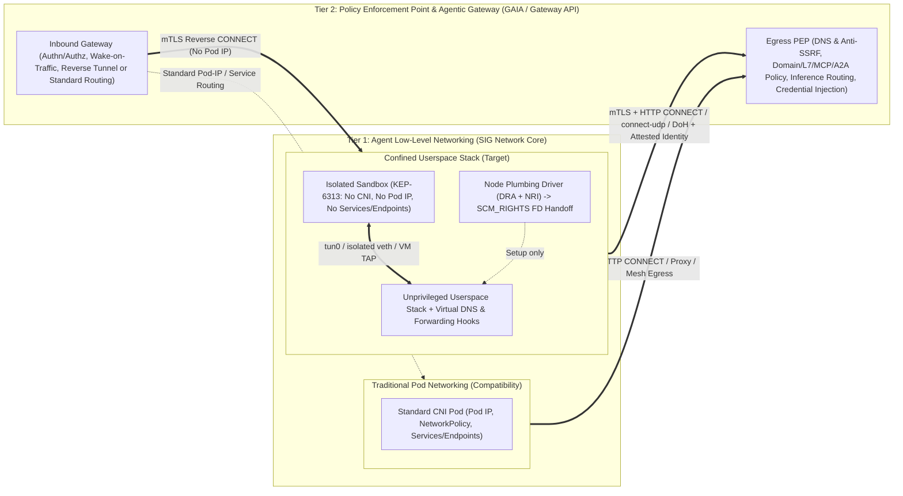

# Kubernetes Networking for the Agentic Era

**Status:** Architecture and Vision Draft  
**Reference Implementation:** [`aojea/agents.net`](https://github.com/aojea/agents.net)  
**Context:** Spin-off of [CNCF Maintainer Summit #126](https://github.com/cncf/maintainer-summit/discussions/126) (*Evolving Kubernetes for Agentic Workloads: Rethinking the Pod and Node Boundary*)

---

## Introduction

Autonomous AI agents do not fit the assumptions Kubernetes networking was built around. As discussed in [CNCF Maintainer Summit #126](https://github.com/cncf/maintainer-summit/discussions/126), agents sit idle most of the time, burst when a tool or user wakes them up, pack at much higher density than regular microservices, run untrusted generated code next to sensitive credentials, and need fast startup and teardown. Because the standard Pod network contract gets in the way of those requirements, platforms like [Agent Substrate](https://github.com/agent-substrate/substrate) and [NVIDIA OpenShell](https://github.com/NVIDIA/OpenShell) are building networking stacks outside Kubernetes and treating clusters mostly as VM managers. If Kubernetes does not update its Pod and node networking boundaries, basic agent plumbing will fragment into incompatible stacks.

Across container runtimes, microVMs, service meshes, and cloud sandboxes, low-level agent networking has largely converged on one pattern: remove direct IP routing from the sandbox and tunnel traffic through HTTP `CONNECT` proxies into Policy Enforcement Points (PEPs). That pattern builds on well-known standards, from early IETF policy models ([RFC 2753](https://www.rfc-editor.org/info/rfc2753), [RFC 3838](https://www.rfc-editor.org/info/rfc3838/)) and Zero Trust Architecture ([NIST SP 800-207](https://csrc.nist.gov/pubs/sp/800/207/final)), to recent IETF drafts on agent enforcement boundaries ([`draft-liu-audit-enforcement-points-00`](https://www.ietf.org/archive/id/draft-liu-audit-enforcement-points-00.html)), to HTTP/2 tunneling in Envoy and [Istio Ambient HBONE](https://istio.io/latest/docs/ambient/architecture/hbone/) ([RFC 9110](https://www.rfc-editor.org/info/rfc9110), [RFC 9298](https://www.rfc-editor.org/info/rfc9298)). Because the wire protocol is standard, Kubernetes can define the node boundary once and work with existing service meshes, gateways, and agent platforms.

This work builds on several years of SIG Network changes. After seeing through [Multi-Network (KEP-3698)](https://github.com/kubernetes/enhancements/issues/3698) and [KEP-4410](https://github.com/kubernetes/enhancements/issues/4410) how brittle it is to bend the core flat Pod-IP model, SIG Network moved toward small core primitives that external drivers can compose:

- At the Contributor Summit in Paris (2024), we started the Kubernetes Network Driver effort to move past monolithic CNI assumptions and serial CNI chaining ([kubernetes#130594](https://github.com/kubernetes/kubernetes/issues/130594)).
- The [Kubernetes Network Driver (KND) model](https://arxiv.org/abs/2506.23628) and [DRANET](https://github.com/kubernetes-sigs/dranet) showed that combining Dynamic Resource Allocation (DRA), [KEP-4817](https://github.com/kubernetes/enhancements/issues/4817) for network device status, and [NRI](https://github.com/containerd/nri) lets standalone node drivers attach NICs and RDMA fabrics without touching the cluster CNI.
- [KEP-6313 (`spec.podNetwork: Isolated`)](https://github.com/kubernetes/enhancements/issues/6313) lets a Pod opt out of the default pod network completely, starting with only a loopback interface, no CNI call, and no Pod IP.

Throughout this work, the goal is the same as with `kube-proxy`, `kindnet`, [`kube-network-policies`](https://github.com/kubernetes-sigs/kube-network-policies), and [`DRANET`](https://github.com/kubernetes-sigs/dranet): keep core Kubernetes small, define clear interfaces, and maintain a small working reference implementation. Paper specs alone move too slowly for fast-moving workloads; when the SIG does not ship working code to test against, external projects build proprietary plumbing instead of feeding lessons back upstream. [`aojea/agents.net`](https://github.com/aojea/agents.net) fills that role as a reference implementation for low-level agent networking on Kubernetes.

---

## 1. Two-Tier Architecture

Agent networking in Kubernetes splits into two tiers with clear ownership and a standard interface between them. This matches the split between Host Enforcement Points and Gateway Enforcement Points in [`draft-liu-audit-enforcement-points-00`](https://www.ietf.org/archive/id/draft-liu-audit-enforcement-points-00.html) and [NIST SP 800-207](https://csrc.nist.gov/pubs/sp/800/207/final).

### Tier 1: Agent Low-Level Networking (SIG Network Core)

SIG Network core owns the node and Pod boundary. Tier 1 needs to support two paths into Tier 2 without letting one hold back the other:

- **Confined userspace stack (target path):** Uses [KEP-6313](https://github.com/kubernetes/enhancements/issues/6313) (`spec.podNetwork: Isolated`), DRA + NRI plumbing with no CNI dependency, file-descriptor handoff, and an unprivileged userspace network stack on the host. It avoids Pod IPs, IPAM, `Service` and `EndpointSlice` churn, and host-kernel TCP/IP exposure, so it can scale for dense, untrusted agent fleets.
- **Traditional Pod networking (compatibility path):** Clusters that do not need strict isolation can still run workloads like [`agent-sandbox`](https://github.com/kubernetes-sigs/agent-sandbox) on existing CNI clusters with Pod IPs, `NetworkPolicy`, Services, and standard proxies, connecting into the same Tier 2 PEPs and gateways. Supporting this path lowers the adoption bar without forcing Pod-IP or IPAM assumptions onto the confined userspace stack.

### Tier 2: Policy Enforcement Points and Agentic Gateways (GAIA)

Policy enforcement and L7 gateways belong in **GAIA**, the Gateway API subproject for agentic networking (egress gateways, inference routing, MCP and A2A governance, off-sandbox credential injection, auditing, and external inbound routing). Policy languages, L7 inspection, and secret stores should live in Tier 2, not inside the node driver.

### Keeping Both Tiers in Sync

Tier 1 and Tier 2 stay aligned by using standard protocols across the hop between them: HTTP `CONNECT` ([RFC 9110](https://www.rfc-editor.org/info/rfc9110)), optional `connect-udp` ([RFC 9298](https://www.rfc-editor.org/info/rfc9298)), optional DoH ([RFC 8484](https://www.rfc-editor.org/info/rfc8484)), `Proxy-Status` ([RFC 9209](https://www.rfc-editor.org/info/rfc9209)), and mandatory mTLS. Tier 1 supplies workload identity and non-IP inbound metadata to GAIA; GAIA gateways can serve both traditional Pod-IP backends and confined IP-less sandboxes. Any existing mesh or proxy that speaks mTLS HTTP/2 `CONNECT` (such as Envoy or Istio HBONE) works as a Tier 2 PEP.

---

## 2. Why Traditional Pod Networking Breaks Down for Agents

Standard CNI networking works fine for typical services, which is why Tier 1 keeps a compatibility path for it. For dense, multi-tenant, untrusted agents, four problems become hard to work around:

1. **Host kernel network exposure.** Every `veth` interface feeds untrusted packets into the host Linux kernel's TCP/IP stack, routing tables, `conntrack`, and `nf_tables` (for example `CVE-2024-1086`). Patching a kernel networking bug means draining and rebooting every node. Systems like **Snap** ([Marty et al., SOSP 2019](https://dl.acm.org/doi/10.1145/3341301.3359657)), **Arrakis** ([Peter et al., OSDI 2014](https://www.usenix.org/conference/osdi14/technical-sessions/presentation/peter)), and **IX** ([Belay et al., OSDI 2014](https://www.usenix.org/conference/osdi14/technical-sessions/presentation/belay)) separate privileged setup from a userspace dataplane so stack bugs are isolated and fixed with a container rollout instead of a kernel reboot.
2. **IP-per-Pod limits density and lifecycle speed.** Agent platforms run hundreds of mostly idle sandboxes per node, maintain warm pools that bind to users on demand, and suspend or resume sandboxes in under a second ([Agent Substrate](https://github.com/agent-substrate/substrate/blob/main/docs/concepts/architecture.md), [Firecracker, NSDI 2020](https://www.usenix.org/conference/nsdi20/presentation/agache)). Giving every sandbox a cluster or VPC IP burns IPAM space and churns CNI plugins, eBPF maps, iptables/nftables rules, and `EndpointSlice` objects for workloads that should never sit on a flat network.
3. **IP firewalls and `HTTP_PROXY` do not enforce agent policy.** External APIs, package registries, and LLM endpoints sit behind shared CDNs with rotating IPs, so IP-based `NetworkPolicy` is brittle and prone to DNS rebinding. `HTTP_PROXY` is only advisory; any binary or generated script that ignores environment variables opens direct sockets unless routes are removed. Keeping API keys or mTLS private keys inside the sandbox means prompt injection or code execution leaks them immediately, which is why [Agent Substrate](https://github.com/agent-substrate/substrate/blob/main/docs/guides/egress-traffic.md) and [OpenShell](https://github.com/NVIDIA/OpenShell/blob/main/docs/about/architecture.mdx) keep credentials outside the sandbox.
4. **In-Pod network sidecars put the boundary in the wrong place.** Adding a TUN proxy sidecar to every sandbox Pod increases per-Pod memory overhead, usually puts `CAP_NET_ADMIN` and `/dev/net/tun` inside the Pod, and ties tenant Pod specs to network infrastructure upgrades.

---

## 3. Tier 1: Host-Side Userspace Networking Without CNI

The target Tier 1 design applies two standard security ideas: privilege separation ([Provos, Friedl, Honeyman, USENIX Security 2003](https://www.usenix.org/conference/12th-usenix-security-symposium/preventing-privilege-escalation)) and passing file descriptors as capabilities ([Capsicum, Watson et al., USENIX Security 2010](https://www.usenix.org/conference/usenixsecurity10/capsicum-practical-capabilities-unix)).

### Standalone Plumbing With One Opinionated Datapath

Tier 1 runs as a standalone Kubernetes Network Driver using DRA (`DRAConsumableCapacity`) for scheduling and claim lifecycle, and NRI (`RunPodSandbox`, `CreateContainer`, `StopPodSandbox`, `RemovePodSandbox`) for Pod plumbing. There is no CNI dependency and only one datapath: host-side userspace networking (`kube-netstack`), with zero sidecars and zero `HTTP_PROXY` variables.

- **Standard Linux containers (`runc`):** With [KEP-6313](https://github.com/kubernetes/enhancements/issues/6313) (`spec.podNetwork: Isolated`), the runtime skips CNI and creates a loopback-only Pod netns. The driver checks loopback-only isolation and creates a persistent L3 `tun0` device inside the Pod netns. On existing CNI clusters without KEP-6313, the driver works alongside the cluster CNI, either blocking `eth0` with `tc clsact` or deferring to CNI `NetworkPolicy` while preserving return routes in table `100` for kubelet probes.
- **`gVisor` (`runsc`) sandboxes:** Because `runsc` snapshots `eth0` and starts its Sentry netstack before NRI `RunPodSandbox` runs, injecting `tun0` afterward is invisible to Sentry. Instead, the driver moves the host-side `veth` peer of `eth0` out of the host network namespace into a fresh empty isolated network namespace, brings it up, opens an `AF_PACKET` socket (`PACKET_IGNORE_OUTGOING=1`), and hands that descriptor to `kube-netstack` in L2 TAP mode. Host kernel routing is completely severed, and unmodified apps inside Sentry talk transparently through `kube-netstack` with no `--host-uds` flag and no `HTTP_PROXY`.
- **KVM microVMs:** A microVM's L2 `virtio-net` socket or TAP descriptor plugs straight into `kube-netstack` in L2 TAP mode (zero in-VM agent), or a zero-NIC microVM (such as Firecracker) can use `AF_VSOCK` with `kube-tun2connect`.

### Privilege Separation Across File Descriptors

Moving packet parsing out of the host kernel only helps if the userspace stack runs without privileges, host secrets, or setup capabilities. This follows OpenSSH's split between a small privileged monitor and an unprivileged parser, and deploys as a two-container DaemonSet Pod sharing only an in-memory `emptyDir` Unix socket (`AF_UNIX SOCK_SEQPACKET` + `SCM_RIGHTS`). Pod-level `automountServiceAccountToken` is `false`; the projected ServiceAccount token is mounted only in the plumbing container.

| Component | Privileges and Isolation | Network Visibility | Access to Secrets / Host State | Parses Raw Sandbox Packets? |
| --- | --- | --- | --- | --- |
| **Sandbox Pod** | Non-root, `drop: ["ALL"]`, no sidecar | `lo` + `tun0` (or isolated `eth0` / `virtio-net`) | None (optional public CA cert only) | Generates them |
| **Userspace Stack (`kube-netstack`)** | Separate container (`65534:65534`), 0 capabilities, `readOnlyRootFilesystem`, own cgroup/memory limit, `PR_SET_NO_NEW_PRIVS`, `AF_UNIX`-only seccomp-BPF (`TSYNC`, blocks `AF_INET`/`AF_INET6`/`AF_NETLINK`/`AF_PACKET`) | None (only passed `tunFD`/`packetFD`/`tapFD` and `brokerFD`) | None (no K8s SA token, no mTLS keys, no `/var/run/netns` or `/var/run/nri`) | Yes (isolated here) |
| **Node Plumbing (`kube-net-driver`)** | Setup-time caps for DRA, NRI, netns plumbing (no cluster `Secret` RBAC) | Host network to PEP, apiserver, optional ingress bridge | Workload mTLS identity (SPIFFE, KEP-4317 `PodCertificate`, X.509) | No (closes packet FD right after `SCM_RIGHTS`) |
| **Tier 2 PEP / GAIA** | Dedicated off-host gateway | Egress network and ingress edge | Upstream API credentials, optional inspection CA key | Only authenticated HTTP `CONNECT` / L7 streams |

Because `tun0` is created with `TUNSETPERSIST` and isolated `veth` namespaces are bind-mounted under the Pod's tmpfs runtime directory, crashing, OOM-killing, or upgrading `kube-netstack` lets `kube-net-driver` reconnect and re-attach live sandboxes without restarting Pods or rebooting nodes. Over time, if container runtimes delegate virtual interface creation via OCI `linux.netDevices` or CRI/NRI FD handoff, the plumbing container can drop `setns` privileges too.

### Virtual DNS, PEP Forwarding, and Inbound Delivery

Because an isolated sandbox has no direct external route, Tier 1 provides three concrete hooks connecting unmodified workloads to Tier 2:

1. **Virtual DNS (Synthetic, Unified PEP DoH, or Separate DNS PEP):** The driver mounts a read-only `/etc/resolv.conf` pointing to `198.19.255.253`, terminated inside `kube-netstack`. Positive answers map to deterministic synthetic addresses in [RFC 2544](https://www.rfc-editor.org/info/rfc2544) (`198.18.0.0/15`) and [RFC 6666](https://www.rfc-editor.org/info/rfc6666) (`100::/64`), with a per-sandbox `(synthetic IP -> hostname)` table. Connections to unmapped synthetic IPs fail closed locally so synthetic addresses never leak upstream, while literal IPs outside the pool pass through as literals. Three DNS modes are supported:
   - *Synthetic (`resolve-all`, default):* Strips `search` and `ndots` from `/etc/resolv.conf` and answers `A`/`AAAA` locally with zero RTT and no DNS exfiltration channel. Works with any plain HTTP `CONNECT` proxy.
   - *Unified PEP DoH ([RFC 8484](https://www.rfc-editor.org/info/rfc8484)):* Forwards `POST /dns-query` over the sandbox's brokered channel and the same mTLS HTTP/2 PEP connection used for `CONNECT` and `connect-udp`. One policy engine enforces allowlists on both DNS and traffic, returning real `NXDOMAIN` for disallowed or missing names so Kubernetes `search` domains, `ndots:5`, short Service names, and client retries work normally. Positive answers are still rewritten to synthetic IPs so real upstream IPs never enter the sandbox.
   - *Separate DNS PEP:* Sends the same RFC 8484 DoH queries to a separate policy-enforcing DNS endpoint (such as a DoH CoreDNS or DNS firewall) when pairing a `CONNECT`-only Traffic PEP with an independent DNS service.
2. **PEP forwarding:** When `kube-netstack` terminates a TCP connection or UDP flow from the guest, it looks up the hostname from Virtual DNS (or keeps a literal IP) and frames it as [RFC 9110](https://www.rfc-editor.org/info/rfc9110) `CONNECT host:port` or [RFC 9298](https://www.rfc-editor.org/info/rfc9298) `connect-udp` ([RFC 9297](https://www.rfc-editor.org/info/rfc9297) capsules over [RFC 8441](https://www.rfc-editor.org/info/rfc8441) extended CONNECT) over a brokered `AF_UNIX` stream to `kube-net-driver`. `kube-net-driver` strips any guest identity headers, adds node-attested workload identity (mTLS client cert SAN / SPIFFE ID and structured attributes), and dials Tier 2 over mTLS. Policy refusals with [RFC 9209](https://www.rfc-editor.org/info/rfc9209) `Proxy-Status` reject the guest socket immediately.
3. **Inbound delivery without Pod IPs:** When a sandbox declares `ingressPorts`, `kube-net-driver` publishes non-IP metadata in `ResourceClaim.status` (bridge endpoint, mTLS server name, Pod UID, sandbox generation, and pinned ports) and accepts mTLS `CONNECT <podUID>:<port>` tunnels from Tier 2 gateways. For `runc` containers, `kube-net-driver` dials `127.0.0.1:<port>` inside the Pod netns via `socketat`. For L2 sandboxes (`gVisor` `veth` and microVM TAP), `kube-net-driver` sends an `OpDialInbound` request over the control socket to `kube-netstack`, which connects directly to the guest IP over the L2 link. Stopping the sandbox revokes active tunnels and published status immediately.

### Pluggable Userspace Stacks, Tenancy, and KEP-5972

Because `kube-net-driver` talks to `kube-netstack` over a small `AF_UNIX SOCK_SEQPACKET` protocol (`add` with `[fd, brokerFD]`, `remove`, `dial_inbound` with `[streamFD]`), the stack implementation and tenancy model are decoupled from DRA and NRI:

- **Shared per-node stack (default):** Like **Snap** ([SOSP 2019](https://dl.acm.org/doi/10.1145/3341301.3359657)) and Istio Ambient `ztunnel`, one shared memory-safe unprivileged stack container per node (`kube-netstack`, built on Go `gVisor netstack`) keeps memory overhead low and attach latency sub-millisecond.
- **Per-tenant stacks and KEP-5972 Dynamic Containers:** Deployments that need stricter per-tenant or per-sandbox stack isolation can run multiple stack containers over the same socket protocol, use child-process `--host-tun-isolation=per-pod`, or use [KEP-5972 (Dynamic Containers)](https://github.com/kubernetes/enhancements/blob/master/keps/sig-node/5972-dynamic-containers/README.md) to add per-tenant stack containers dynamically or perform zero-downtime stack upgrades by handing persistent `tun0` FDs to a new stack container before stopping the old one. On the workload side, dynamic tool containers added to a pre-warmed Pod automatically inherit `tun0` and `/etc/resolv.conf` through NRI `CreateContainer`.
- **Bring Your Own Stack (BYOS):** Go `gVisor netstack` is the default image, while Rust (`smoltcp`, Fuchsia `Netstack3`) or C (`lwIP`) stacks can swap into `containers[1].image` behind the same socket contract.

---

## 4. Tier 2 Delegation and Ecosystem Compatibility

Delegating Tier 2 to **GAIA** over mTLS HTTP `CONNECT` / `connect-udp` / DoH lets Kubernetes work with existing infrastructure and agent platforms:

- **GAIA (Gateway API):** GAIA owns egress gateways, inference routing, MCP and A2A policy, credential injection, and SPIFFE-based agent identity. Tier 2 gateways can serve traditional CNI Pods while also consuming Tier 1 mTLS egress streams and IP-less reverse-tunnel ingress metadata without needing Pod IPs or `EndpointSlice` objects for isolated sandboxes.
- **Service meshes and proxies:** Because Tier 1 speaks standard HTTP/2 `CONNECT`, `connect-udp`, and DoH over mTLS, Envoy, [Istio Ambient HBONE](https://istio.io/latest/docs/ambient/architecture/hbone/), and cloud Secure Web Gateways can act as Tier 2 PEPs with no custom node driver.
- **SIG Apps [`agent-sandbox`](https://github.com/kubernetes-sigs/agent-sandbox):** `Sandbox`, `SandboxWarmPool`, and `SandboxClaim` run on regular CNI clusters and opt into Tier 1 confinement via `podTemplate.spec.resourceClaims` with no CRD changes. Warm pools start confined and rebind attested identity on claim adoption.
- **Agent Substrate, OpenShell, and microVM runtimes:** [Agent Substrate](https://github.com/agent-substrate/substrate) (`atenet-egress` PEP with off-sandbox credentials and `atenet-router` reverse `CONNECT` over gVisor/Cloud Hypervisor/Kata) and [NVIDIA OpenShell](https://github.com/NVIDIA/OpenShell) (default-deny outer fence, HTTP/2 channel to a trusted supervisor, DNS/TCP mediation, credential brokering) follow the same two-tier split.

---

## 5. Reference Implementation and E2E Coverage

[`aojea/agents.net`](https://github.com/aojea/agents.net) ships five single-purpose binaries: `kube-net-driver`, `kube-netstack`, `kube-pep`, `kube-inbound`, and `kube-tun2connect`. Four end-to-end test suites validate the full matrix of isolation runtimes and Tier 2 proxies:

- **`runc` containers (`test/smoke.sh`):** `kind` v1.36 with two-container `kube-net-driver` + `kube-netstack` (L3 `tun0`), `Synthetic` and `DoH` DNS modes, `kube-pep`, and IP-less inbound via `kube-inbound` (`LoadBalancer`).
- **Unmodified Envoy Proxy (`test/envoy/run.sh`):** Envoy `v1.36.2` terminating mandatory mTLS HTTP/2 `CONNECT` (`dynamic_forward_proxy` + RBAC), proxying `connect-udp` and RFC 8484 `POST /dns-query` DoH on the same listener, and originating inbound mTLS `CONNECT <podUID>:<port>` tunnels via `internal_listener` + `tcp_proxy` `tunneling_config`.
- **`gVisor` (`runsc`) sandboxes (`test/gvisor/run.sh`):** `kind` v1.36 with `RuntimeClass: gvisor` (`platform = "systrap"`, zero `--host-uds`, zero `HTTP_PROXY`). `kube-net-driver` moves the host `veth` peer into an isolated empty netns and hands an `AF_PACKET` FD to `kube-netstack` (`LinkModeTAP`), validating unmodified Python DNS (DoH + search domains + `NXDOMAIN`), HTTPS, UDP (`connect-udp`), direct-IP blocking, and IP-less inbound via `kube-inbound` -> `OpDialInbound` -> `ThreadingHTTPServer` inside Sentry.
- **KVM microVMs (`test/microvm/run.sh`):** Runs on `/dev/kvm` covering both zero-agent QEMU L2 `virtio-net` (`AF_UNIX SOCK_DGRAM` -> `kube-netstack` `LinkModeTAP` + `OpDialInbound`) and zero-NIC Firecracker `v1.16.1` (`AF_VSOCK` -> `kube-tun2connect -h2 -udp -doh` -> `kube-pep` + `vsock` inbound).

### Open Sync Points Between SIG Network Core and GAIA

1. **Dual-mode ingress in GAIA / Gateway API:** How should Gateway API model `spec.podNetwork: Isolated` sandboxes for mTLS HTTP/2 `CONNECT` reverse tunnels alongside Pod-IP backends without reintroducing `Service` or `EndpointSlice` churn?
2. **Shared workload identity contract:** How should node-attested identity (SPIFFE X.509-SVID, KEP-4317 `PodCertificate`, and structured attributes) be standardized across Tier 1 drivers, GAIA policies, and meshes?
3. **Runtime delegation without CNI:** Can container runtimes (via CRI/NRI or OCI `linux.netDevices`) create the sandbox interface before starting the sandbox (including `runsc` Sentry) and hand its FD to the Tier 1 driver, removing `setns` from the node DaemonSet without depending on CNI?
4. **Minimal BYOS worker boundary:** What is the smallest useful contract between a node plumbing driver and an unprivileged userspace stack (`add`, `remove`, `dial_inbound`, Virtual DNS, PEP forwarding) so multiple stack implementations can plug in cleanly?

---

## References

### Policy Enforcement, Zero Trust, and Agent Auditing
- **RFC 2753** — R. Yavatkar, D. Pendarakis, R. Guerin, *A Framework for Policy-based Admission Control*, IETF, January 2000. https://www.rfc-editor.org/info/rfc2753
- **RFC 3838** — A. Barbir, O. Batuner, A. Beck, T. Chan, H. Orman, *Policy, Authorization, and Enforcement Requirements of the Open Pluggable Edge Services (OPES)*, IETF, August 2004. https://www.rfc-editor.org/info/rfc3838/
- **NIST SP 800-207** — S. Rose, O. Borchert, S. Mitchell, S. Connelly, *Zero Trust Architecture*, NIST, August 2020. https://csrc.nist.gov/pubs/sp/800/207/final
- **IETF Internet-Draft** — C. P. Liu, Y. Ni, *Enforcement Points for Agents* (`draft-liu-audit-enforcement-points-00`), IETF, 2026. https://www.ietf.org/archive/id/draft-liu-audit-enforcement-points-00.html

### HTTP Tunneling, Proxying, and Addressing Standards
- **RFC 9110** — R. Fielding, M. Nottingham, J. Reschke, *HTTP Semantics* (`CONNECT`), IETF, June 2022. https://www.rfc-editor.org/info/rfc9110
- **RFC 8441** — P. McManus, *Bootstrapping WebSockets with HTTP/2* (Extended `CONNECT`), IETF, September 2018. https://www.rfc-editor.org/info/rfc8441
- **RFC 9297 / RFC 9298** — D. Schinazi, L. Pardue, *HTTP Datagrams and the Capsule Protocol* / *Proxying UDP in HTTP (`connect-udp`)*, IETF, August 2022. https://www.rfc-editor.org/info/rfc9298
- **RFC 8484** — P. Hoffman, P. McManus, *DNS Queries over HTTPS (DoH)*, IETF, October 2018. https://www.rfc-editor.org/info/rfc8484
- **RFC 9209** — M. Nottingham, P. Sikora, *The Proxy-Status HTTP Response Header Field*, IETF, June 2022. https://www.rfc-editor.org/info/rfc9209
- **RFC 2544 / RFC 6666** — Dedicated non-overlapping benchmark/discard address blocks (`198.18.0.0/15`, `100::/64`). https://www.rfc-editor.org/info/rfc2544, https://www.rfc-editor.org/info/rfc6666

### Userspace Networking, Privilege Separation, and Sandboxing Literature
- **OpenSSH Privilege Separation** — N. Provos, M. Friedl, P. Honeyman, *Preventing Privilege Escalation*, USENIX Security 2003. https://www.usenix.org/conference/12th-usenix-security-symposium/preventing-privilege-escalation
- **Capsicum** — R. N. M. Watson, J. Anderson, B. Laurie, K. Kennaway, *Capsicum: Practical Capabilities for UNIX*, USENIX Security 2010. https://www.usenix.org/conference/usenixsecurity10/capsicum-practical-capabilities-unix
- **Arrakis** — S. Peter et al., *Arrakis: The Operating System is the Control Plane*, USENIX OSDI 2014. https://www.usenix.org/conference/osdi14/technical-sessions/presentation/peter
- **IX** — A. Belay et al., *IX: A Protected Dataplane Operating System for High Throughput and Low Latency*, USENIX OSDI 2014. https://www.usenix.org/conference/osdi14/technical-sessions/presentation/belay
- **Snap** — M. Marty et al., *Snap: a Microkernel Approach to Host Networking*, ACM SOSP 2019. https://dl.acm.org/doi/10.1145/3341301.3359657
- **Firecracker** — A. Agache et al., *Firecracker: Lightweight Virtualization for Serverless Applications*, USENIX NSDI 2020. https://www.usenix.org/conference/nsdi20/presentation/agache
- **Kubernetes Network Driver Model** — A. Ojea et al., *The Kubernetes Network Driver Model: A Composable Architecture for High-Performance Networking*, IEEE LCN 2025 (`arXiv:2506.23628`). https://arxiv.org/abs/2506.23628

### Kubernetes, Service Mesh, and Agentic Ecosystem Projects
- **CNCF Maintainer Summit #126** — *Evolving Kubernetes for Agentic Workloads: Rethinking the Pod and Node Boundary*. https://github.com/cncf/maintainer-summit/discussions/126
- **KEP-6313** — *Network-Isolated Pod Sandboxes (`spec.podNetwork: Isolated`)*. https://github.com/kubernetes/enhancements/issues/6313
- **KEP-5972** — *Dynamic Containers*. https://github.com/kubernetes/enhancements/blob/master/keps/sig-node/5972-dynamic-containers/README.md
- **KEP-4817** — *Resource Claim Status for Network Devices*. https://github.com/kubernetes/enhancements/issues/4817
- **KEP-4317** — *Pod Certificates*. https://github.com/kubernetes/enhancements/issues/4317
- **DRANET & Kubernetes Network Drivers** — https://github.com/kubernetes-sigs/dranet, https://github.com/kubernetes-sigs/kubernetes-network-drivers
- **Kubernetes `agent-sandbox`** — https://github.com/kubernetes-sigs/agent-sandbox
- **Istio Ambient Mesh HBONE** — https://istio.io/latest/docs/ambient/architecture/hbone/
- **Agent Substrate** — *Architecture & Egress Traffic Guides*. https://github.com/agent-substrate/substrate
- **NVIDIA OpenShell** — *Architecture & Sandboxed Supervision*. https://github.com/NVIDIA/OpenShell
