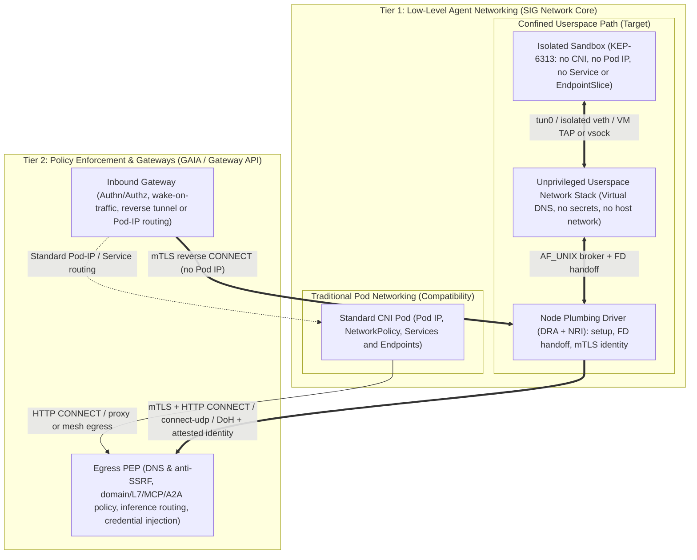

# Kubernetes Networking for the Agentic Era

**Status:** Architecture and Vision Draft  
**Reference Implementation:** [`aojea/agents.net`](https://github.com/aojea/agents.net)  
**Context:** Spin-off of [CNCF Maintainer Summit #126](https://github.com/cncf/maintainer-summit/discussions/126) (*Evolving Kubernetes for Agentic Workloads: Rethinking the Pod and Node Boundary*)

---

## Introduction

Autonomous AI agents do not fit the assumptions behind standard Kubernetes networking. As discussed at [CNCF Maintainer Summit #126](https://github.com/cncf/maintainer-summit/discussions/126), agents sit idle most of the time, wake up in bursts when a user or tool calls them, pack at high density onto nodes, and run untrusted generated code next to sensitive credentials. Because the standard Pod network model gets in the way of those requirements, platforms such as [Agent Substrate](https://github.com/agent-substrate/substrate) and [NVIDIA OpenShell](https://github.com/NVIDIA/OpenShell) build their own networking outside Kubernetes and treat clusters mostly as VM managers. If Kubernetes does not update its Pod and node networking boundaries, low-level agent plumbing will split into incompatible stacks.

Across container runtimes, microVMs, service meshes, and cloud sandboxes, agent networking has converged on one pattern: remove direct IP routing from the sandbox and tunnel traffic through HTTP `CONNECT` proxies into Policy Enforcement Points (PEPs). That pattern rests on established standards, from early IETF policy frameworks ([RFC 2753](https://www.rfc-editor.org/info/rfc2753), [RFC 3838](https://www.rfc-editor.org/info/rfc3838/)) and Zero Trust Architecture ([NIST SP 800-207](https://csrc.nist.gov/pubs/sp/800/207/final)), to recent IETF drafts on agent enforcement boundaries ([`draft-liu-audit-enforcement-points-00`](https://www.ietf.org/archive/id/draft-liu-audit-enforcement-points-00.html)), to HTTP/2 tunneling in Envoy and [Istio Ambient HBONE](https://istio.io/latest/docs/ambient/architecture/hbone/) ([RFC 9110](https://www.rfc-editor.org/info/rfc9110), [RFC 9298](https://www.rfc-editor.org/info/rfc9298)). Using standard wire protocols lets Kubernetes define the node boundary once and work with existing service meshes, gateways, and agent platforms.

This work builds on several years of SIG Network changes. After seeing through [Multi-Network (KEP-3698)](https://github.com/kubernetes/enhancements/issues/3698) and [KEP-4410](https://github.com/kubernetes/enhancements/issues/4410) how brittle it is to bend the flat Pod-IP model, SIG Network moved toward small core primitives that external drivers compose:

- At the 2024 Paris Contributor Summit, SIG Network started the Kubernetes Network Driver effort to move past monolithic CNI assumptions and serial CNI chaining ([kubernetes#130594](https://github.com/kubernetes/kubernetes/issues/130594)).
- The [Kubernetes Network Driver (KND) model](https://arxiv.org/abs/2506.23628) and [DRANET](https://github.com/kubernetes-sigs/dranet) showed that Dynamic Resource Allocation (DRA), [KEP-4817](https://github.com/kubernetes/enhancements/issues/4817) for network device status, and [NRI](https://github.com/containerd/nri) let standalone node drivers attach network devices without changing the cluster CNI.
- [KEP-6313](https://github.com/kubernetes/enhancements/issues/6313) (merged as Alpha in v1.38 via [kubernetes#143280](https://github.com/kubernetes/kubernetes/pull/143280)) adds `spec.podNetwork: Isolated`, letting a Pod opt out of the default pod network with only a loopback interface, no CNI call, and no Pod IP, failing closed if the runtime does not advertise `pod_network_isolated`.

The goal is the same as with `kube-proxy`, `kindnet`, [`kube-network-policies`](https://github.com/kubernetes-sigs/kube-network-policies), and [`DRANET`](https://github.com/kubernetes-sigs/dranet): keep core Kubernetes small, define clear boundaries, and back the design with a working reference implementation ([`aojea/agents.net`](https://github.com/aojea/agents.net)). Paper specs alone move too slowly; without working code to test against, external projects build separate plumbing instead of feeding lessons back upstream.

---

## 1. Two-Tier Architecture

Agent networking in Kubernetes splits into two tiers with separate owners and a standard protocol between them. This matches the split between Host Enforcement Points and Gateway Enforcement Points in [`draft-liu-audit-enforcement-points-00`](https://www.ietf.org/archive/id/draft-liu-audit-enforcement-points-00.html) and [NIST SP 800-207](https://csrc.nist.gov/pubs/sp/800/207/final).

### Tier 1: Low-Level Agent Networking (SIG Network Core)

SIG Network core owns the node and Pod boundary. Tier 1 supports two paths into Tier 2 so clusters can adopt strict confinement without breaking existing setups:

- **Confined userspace path (target):** Uses [KEP-6313](https://github.com/kubernetes/enhancements/issues/6313) (`spec.podNetwork: Isolated`), DRA and NRI plumbing with no CNI dependency, file-descriptor handoff, and an unprivileged userspace network stack on the host. It avoids Pod IPs, IPAM, `Service` and `EndpointSlice` churn, and host-kernel TCP/IP exposure for dense, untrusted agent fleets.
- **Traditional Pod networking (compatibility):** Clusters that do not need strict isolation can keep running workloads such as [`agent-sandbox`](https://github.com/kubernetes-sigs/agent-sandbox) on existing CNI clusters with Pod IPs, `NetworkPolicy`, Services, and standard proxies, routing into the same Tier 2 PEPs and gateways.

### Tier 2: Policy Enforcement Points and Agentic Gateways (GAIA)

Policy enforcement and L7 gateways belong in **GAIA**, the Gateway API subproject for agentic networking. GAIA owns egress gateways, inference routing, MCP and A2A policy, off-sandbox credential injection, auditing, and external inbound routing. Policy languages, L7 inspection, and secret stores stay in Tier 2 rather than inside node drivers.

### Boundary Between Both Tiers

Tier 1 and Tier 2 communicate over standard protocols: HTTP `CONNECT` ([RFC 9110](https://www.rfc-editor.org/info/rfc9110)), optional `connect-udp` ([RFC 9298](https://www.rfc-editor.org/info/rfc9298)), optional DNS over HTTPS ([RFC 8484](https://www.rfc-editor.org/info/rfc8484)), `Proxy-Status` ([RFC 9209](https://www.rfc-editor.org/info/rfc9209)), and mandatory mTLS. Tier 1 supplies node-attested workload identity and non-IP inbound metadata to Tier 2, so GAIA gateways can serve both regular Pod-IP backends and IP-less sandboxes. Any existing proxy or mesh that speaks mTLS HTTP/2 `CONNECT`, such as Envoy or Istio HBONE, works as a Tier 2 PEP.

---

## 2. Why Traditional Pod Networking Breaks Down for Agents

Standard CNI networking works well for typical services, which is why Tier 1 keeps a compatibility path for it. For dense, multi-tenant, untrusted agents, four problems get in the way:

1. **Host kernel network exposure.** Every `veth` interface feeds untrusted packets into the host Linux kernel TCP/IP stack, routing tables, `conntrack`, and `nf_tables` (for example `CVE-2024-1086`). Patching a kernel networking bug requires draining and rebooting every node. Systems such as **Snap** ([Marty et al., SOSP 2019](https://dl.acm.org/doi/10.1145/3341301.3359657)), **Arrakis** ([Peter et al., OSDI 2014](https://www.usenix.org/conference/osdi14/technical-sessions/presentation/peter)), and **IX** ([Belay et al., OSDI 2014](https://www.usenix.org/conference/osdi14/technical-sessions/presentation/belay)) separate privileged setup from a userspace dataplane so stack bugs stay isolated and are patched with a container rollout instead of a node reboot.
2. **IP-per-Pod limits density and lifecycle speed.** Agent platforms run hundreds of mostly idle sandboxes per node, hold warm pools that bind to users on demand, and suspend or resume sandboxes in under a second ([Agent Substrate](https://github.com/agent-substrate/substrate/blob/main/docs/concepts/architecture.md), [Firecracker, NSDI 2020](https://www.usenix.org/conference/nsdi20/presentation/agache)). Giving every sandbox a cluster or VPC IP burns IPAM space and churns CNI plugins, eBPF maps, iptables or nftables rules, and `EndpointSlice` objects for workloads that should not sit on a flat network.
3. **IP firewalls and `HTTP_PROXY` do not enforce agent policy.** External APIs, package registries, and model endpoints sit behind shared CDNs with rotating IPs, so IP-based `NetworkPolicy` breaks and allows DNS rebinding. `HTTP_PROXY` is only advisory; any binary or generated script that ignores environment variables opens direct sockets unless routes are removed. Keeping API keys or mTLS private keys inside the sandbox leaks them on prompt injection or code execution, which is why [Agent Substrate](https://github.com/agent-substrate/substrate/blob/main/docs/guides/egress-traffic.md) and [OpenShell](https://github.com/NVIDIA/OpenShell/blob/main/docs/about/architecture.mdx) keep credentials outside the sandbox.
4. **In-Pod proxy sidecars put the boundary in the wrong place.** Adding a proxy or TUN sidecar to every sandbox Pod increases per-Pod memory cost, often puts `CAP_NET_ADMIN` and `/dev/net/tun` inside the Pod, and ties tenant Pod specs to network infrastructure upgrades.

---

## 3. Tier 1: Host-Side Userspace Networking Without CNI

The target Tier 1 architecture applies two standard security ideas: privilege separation ([Provos, Friedl, Honeyman, USENIX Security 2003](https://www.usenix.org/conference/12th-usenix-security-symposium/preventing-privilege-escalation)) and passing file descriptors as capabilities ([Capsicum, Watson et al., USENIX Security 2010](https://www.usenix.org/conference/usenixsecurity10/capsicum-practical-capabilities-unix)).

### Standalone Plumbing With One Host-Side Datapath

Tier 1 runs as a standalone Kubernetes Network Driver using DRA for scheduling and claim lifecycle, and NRI for Pod plumbing. It has no CNI dependency and uses one host-side userspace network stack across isolation runtimes, with no in-Pod sidecars and no `HTTP_PROXY` environment variables.

- **Standard Linux containers (`runc`):** With [KEP-6313](https://github.com/kubernetes/enhancements/issues/6313) (`spec.podNetwork: Isolated`), the runtime skips CNI and creates a loopback-only Pod network namespace. The node driver verifies loopback-only isolation and creates a persistent L3 TUN device inside the Pod network namespace, then passes its file descriptor to the userspace network stack. On clusters without KEP-6313, the driver runs alongside the cluster CNI by blocking `eth0` egress or deferring to `NetworkPolicy` while keeping kubelet probes working.
- **`gVisor` (`runsc`) sandboxes:** Because `runsc` captures `eth0` and starts its Sentry network stack before NRI `RunPodSandbox` runs, injecting a TUN device afterward is invisible to Sentry. Instead, the node driver moves the host-side `veth` peer of `eth0` out of the host network namespace into a fresh empty isolated network namespace, opens an `AF_PACKET` socket on it, and hands that descriptor to the userspace network stack in L2 TAP mode. Host kernel routing is cut off, and unmodified workloads inside Sentry run without host-UDS flags or proxy environment variables.
- **KVM microVMs:** A microVM's L2 `virtio-net` socket or TAP descriptor attaches directly to the userspace network stack in L2 mode with no in-VM networking agent. Zero-NIC microVMs such as Firecracker can instead connect over `AF_VSOCK` to the node proxy channel.

### Privilege Separation Across File Descriptors

Moving packet parsing out of the host kernel only helps if the userspace network stack runs without privileges, host network access, or secrets. Following OpenSSH's split between a small privileged monitor and an unprivileged worker, Tier 1 deploys as a two-container node DaemonSet sharing only an in-memory Unix domain socket (`AF_UNIX SOCK_SEQPACKET` with `SCM_RIGHTS`). Only the plumbing container mounts a Kubernetes ServiceAccount token.

The table below shows how privileges, network access, secrets, and raw packet parsing split across each component.

| Component | Privileges and Isolation | Network Visibility | Access to Secrets / Host State | Parses Raw Sandbox Packets? |
| --- | --- | --- | --- | --- |
| **Sandbox Pod** | Non-root, drop ALL capabilities, no proxy sidecar | Loopback plus virtual interface (TUN, isolated `veth`, or `virtio-net`/`vsock`) | None (optional public CA cert only) | Generates them |
| **Userspace Network Stack** | Unprivileged container, zero capabilities, read-only rootfs, own cgroup and memory limit, `no_new_privs`, `AF_UNIX`-only seccomp filter | None (only passed sandbox interface FD and broker FD) | None (no Kubernetes SA token, no mTLS keys, no host netns or NRI paths) | Yes (isolated here) |
| **Node Plumbing Driver** | Setup-time capabilities for DRA, NRI, and network setup (no cluster `Secret` RBAC) | Host network to PEP, API server, and optional ingress bridge | Workload mTLS identity (SPIFFE, KEP-4317 `PodCertificate`, X.509) | No (closes sandbox FD right after handoff) |
| **Tier 2 PEP / GAIA** | Dedicated off-host gateway | Egress network and ingress edge | Upstream API credentials, optional inspection CA key | No (only authenticated HTTP `CONNECT` and L7 streams) |

Because sandbox interfaces are persistent (persistent TUN devices or bind-mounted isolated `veth` namespaces), crashing, OOM-killing, or upgrading the userspace network stack container lets the node plumbing driver reconnect and re-attach live sandboxes without restarting Pods or rebooting nodes. Over time, if container runtimes delegate virtual interface creation via OCI `linux.netDevices` or CRI/NRI file-descriptor handoff, the plumbing container can drop `setns` privileges too.

### Virtual DNS, Proxy Forwarding, and Inbound Delivery

Because an isolated sandbox has no direct external route, Tier 1 exposes three mechanisms that connect unmodified workloads to Tier 2:

1. **Virtual DNS (Synthetic, Unified PEP DoH, or Separate DNS PEP):** The node driver mounts a read-only `/etc/resolv.conf` pointing to an internal resolver inside the userspace network stack. Positive answers map to deterministic synthetic addresses in [RFC 2544](https://www.rfc-editor.org/info/rfc2544) (`198.18.0.0/15`) and [RFC 6666](https://www.rfc-editor.org/info/rfc6666) (`100::/64`) tracked per sandbox. Connections to unmapped synthetic IPs fail closed locally so synthetic addresses never leak upstream, while literal IPs outside the pool pass through as literals. Three DNS modes fit different deployments:
   - *Synthetic (`resolve-all`):* Strips `search` domains and `ndots` from `/etc/resolv.conf` and answers `A`/`AAAA` locally with zero round trips and no DNS exfiltration channel. Works with any plain HTTP `CONNECT` proxy.
   - *Unified PEP DoH ([RFC 8484](https://www.rfc-editor.org/info/rfc8484)):* Forwards DNS-over-HTTPS queries over the sandbox's brokered channel and the same mTLS HTTP/2 PEP connection used for traffic. One policy engine enforces allowlists on both DNS and traffic, returning real `NXDOMAIN` for missing or disallowed names so Kubernetes `search` domains, `ndots:5`, short Service names, and client retries keep working while real upstream IPs stay hidden from the sandbox.
   - *Separate DNS PEP:* Sends the same RFC 8484 DoH queries to an independent policy-enforcing DNS resolver or DNS firewall when pairing a `CONNECT`-only traffic PEP with a separate DNS service.
2. **PEP forwarding:** When the userspace network stack terminates a guest TCP connection or UDP flow, it maps the synthetic IP back to its hostname (or keeps a literal IP) and frames the stream as [RFC 9110](https://www.rfc-editor.org/info/rfc9110) `CONNECT host:port` or [RFC 9298](https://www.rfc-editor.org/info/rfc9298) `connect-udp` ([RFC 9297](https://www.rfc-editor.org/info/rfc9297) capsules over [RFC 8441](https://www.rfc-editor.org/info/rfc8441) extended CONNECT) across a brokered `AF_UNIX` stream to the node plumbing driver. The driver strips any guest identity headers, attaches node-attested workload identity, and dials Tier 2 over mTLS. Policy refusals carrying [RFC 9209](https://www.rfc-editor.org/info/rfc9209) `Proxy-Status` reject the guest socket immediately.
3. **Inbound delivery without Pod IPs:** When a sandbox declares inbound ports, the node driver publishes non-IP connection metadata in `ResourceClaim.status` ([KEP-4817](https://github.com/kubernetes/enhancements/issues/4817)) and accepts mTLS reverse `CONNECT` tunnels from Tier 2 gateways. For L3 container sandboxes, the driver dials loopback inside the Pod network namespace. For L2 sandboxes (`gVisor` isolated `veth` and microVM TAP), the driver asks the userspace network stack over the control socket to dial the guest IP over the L2 link. Stopping the sandbox closes active tunnels and removes published status right away.

### Pluggable Userspace Stacks and Tenancy

Because the node plumbing driver talks to the userspace network stack over a small `AF_UNIX` control contract (attach interface and broker FDs, detach, and dial inbound), the stack implementation and tenancy model stay independent of DRA and NRI:

- **Shared per-node stack:** Like **Snap** ([SOSP 2019](https://dl.acm.org/doi/10.1145/3341301.3359657)) and Istio Ambient `ztunnel`, one shared memory-safe unprivileged stack container per node keeps memory overhead low and attach latency sub-millisecond.
- **Per-tenant stacks and live upgrades:** Deployments needing stricter per-tenant or per-sandbox stack isolation can run multiple stack containers or per-Pod worker processes behind the same socket contract. With [KEP-5972 (Dynamic Containers)](https://github.com/kubernetes/enhancements/blob/master/keps/sig-node/5972-dynamic-containers/README.md), a node can add per-tenant stack containers on demand or upgrade a stack container with zero downtime by handing persistent FDs to the new container before stopping the old one.
- **Bring Your Own Stack (BYOS):** Any memory-safe userspace TCP/IP stack (for example in Go, Rust, or C) can plug into the same socket contract without changing the DRA/NRI driver or Tier 2 proxies.

### Alignment With SIG Node Process Layer Primitives

Resource management (Pod-level resources, in-place resize, writable cgroups, swap, overcommit), scheduling, storage, and VMM lifecycle belong in SIG Node, SIG Scheduling, and SIG Storage, not in SIG Network. Tier 1 networking stays out of those layers, but removing Pod IPs, CNI calls, and in-Pod proxy sidecars lines up directly with the Process Layer work from [CNCF Maintainer Summit #126](https://github.com/cncf/maintainer-summit/discussions/126):

- **Isolated Containers (VM-as-a-Container):** When one Pod envelope combines trusted containers (such as an agent loop) with untrusted isolated containers (microVM or gVisor per container), the FD-based userspace stack contract extends from per-Pod attach to per-isolated-container attach. Each isolated container gets its own egress channel, Virtual DNS table, and per-container identity, with no L3 path to sibling containers and no network stack or VMM bundled inside the workload image.
- **Dynamic Containers ([KEP-5972](https://github.com/kubernetes/enhancements/blob/master/keps/sig-node/5972-dynamic-containers/README.md)) and node-local lifecycles:** Dynamic tool containers added to a pre-warmed Pod inherit the sandbox interface and `/etc/resolv.conf` through NRI `CreateContainer`. Because Tier 1 creates no Pod IPs, Services, or `EndpointSlice` objects per unit, sub-Pod and future node-local actor lifecycles add zero control-plane network churn.
- **Pod and container suspend/freeze:** Traditional CNI sandboxes keep holding Pod IPs while paused and leave stale TCP connections or expired tokens behind on resume. With `spec.podNetwork: Isolated`, a suspended sandbox holds no Pod IP. Suspending closes active mTLS `CONNECT` and inbound tunnels, so resuming forces fresh authorization at the Tier 2 PEP (preserving executor identity without preserving stale grants) and lets Tier 2 gateways wake idle sandboxes on inbound traffic without IP or NAT setup.
- **Checkpoint and restore ([KEP-5823](https://github.com/kubernetes/enhancements/blob/master/keps/sig-node/5823-pod-level-checkpoint-restore/README.md)):** Because the guest uses only local synthetic addresses and holds no secrets or mTLS private keys, restoring or cloning a checkpoint onto any node requires no IP mobility and no NAT-on-restore. The target node's driver attaches a fresh FD and binds new node-attested identity on restore.
- **High node density and runtime capabilities:** Dropping per-Pod proxy sidecars saves memory inside Pod-level resource budgets, and keeping untrusted packets out of the host kernel avoids host ARP, `conntrack`, and `nf_tables` exhaustion at 500+ sandboxes per node. Skipping CNI also takes CNI setup off the `RunPodSandbox` latency path, and plumbing `pod_network_isolated` follows the same fail-closed capability advertisement model (`Node.status.runtimeHandlers[].features`) as other SIG Node runtime features.

---

## 4. Tier 2 Delegation and Ecosystem Compatibility

Delegating Tier 2 to **GAIA** over mTLS HTTP `CONNECT`, `connect-udp`, and DoH keeps Kubernetes aligned with existing infrastructure and agent platforms:

- **GAIA (Gateway API):** GAIA owns egress gateways, inference routing, MCP and A2A policy, credential injection, and SPIFFE-based agent identity. Tier 2 gateways serve traditional CNI Pods while also handling Tier 1 mTLS egress streams and IP-less reverse-tunnel ingress metadata without Pod IPs or `EndpointSlice` objects for isolated sandboxes.
- **Service meshes and proxies:** Because Tier 1 speaks standard HTTP/2 `CONNECT`, `connect-udp`, and DoH over mTLS, Envoy, [Istio Ambient HBONE](https://istio.io/latest/docs/ambient/architecture/hbone/), and cloud Secure Web Gateways act as Tier 2 PEPs without a custom node driver.
- **SIG Apps [`agent-sandbox`](https://github.com/kubernetes-sigs/agent-sandbox):** `Sandbox`, `SandboxWarmPool`, and `SandboxClaim` run on regular CNI clusters and opt into Tier 1 confinement through `podTemplate.spec.resourceClaims` with no CRD changes. Warm pools start confined and rebind attested identity when claimed.
- **Agent Substrate, OpenShell, and microVM runtimes:** [Agent Substrate](https://github.com/agent-substrate/substrate) (off-sandbox egress PEP and reverse-`CONNECT` router over gVisor, Cloud Hypervisor, and Kata) and [NVIDIA OpenShell](https://github.com/NVIDIA/OpenShell) (default-deny outer fence, HTTP/2 channel to a trusted supervisor, DNS/TCP mediation, and external credential brokering) follow the same two-tier split.

---

## 5. Reference Implementation

[`aojea/agents.net`](https://github.com/aojea/agents.net) is a concrete reference implementation of this architecture. It ships five small binaries, one per architectural role: `kube-net-driver` (DRA + NRI node plumbing driver), `kube-netstack` (unprivileged Go gVisor netstack userspace worker), `kube-pep` (reference Tier 2 egress and DoH PEP), `kube-inbound` (reference Tier 2 IP-less inbound gateway), and `kube-tun2connect` (in-guest `AF_VSOCK` helper for zero-NIC Firecracker microVMs).

Four end-to-end test suites exercise the runtime and proxy matrix:

- **`runc` containers (`test/smoke.sh`):** Kind cluster running the two-container `kube-net-driver` and `kube-netstack` DaemonSet over L3 TUN, validating Synthetic and DoH DNS modes, `kube-pep`, and IP-less inbound via `kube-inbound`.
- **Unmodified Envoy Proxy (`test/envoy/run.sh`):** Stock Envoy terminating mandatory mTLS HTTP/2 `CONNECT` (`dynamic_forward_proxy` and RBAC), proxying `connect-udp` and RFC 8484 DoH on the same listener, and originating inbound mTLS `CONNECT` tunnels via `internal_listener` and `tcp_proxy` `tunneling_config`.
- **`gVisor` sandboxes (`test/gvisor/run.sh`):** Kind cluster with `RuntimeClass: gvisor` (`systrap`, no host-UDS flag, no `HTTP_PROXY`), isolating the host `veth` peer into an empty netns and passing an `AF_PACKET` FD to `kube-netstack` in L2 TAP mode to validate unmodified Python DNS (DoH, search domains, `NXDOMAIN`), HTTPS, UDP, direct-IP blocking, and IP-less inbound.
- **KVM microVMs (`test/microvm/run.sh`):** Runs on `/dev/kvm` covering both zero-agent QEMU L2 `virtio-net` (into `kube-netstack` L2 TAP mode) and zero-NIC Firecracker over `AF_VSOCK` (via `kube-tun2connect` to `kube-pep` and `vsock` inbound).

---

## 6. Open Sync Points Across SIG Network, SIG Node, and GAIA

1. **Dual-mode ingress and wake-on-traffic in GAIA / Gateway API:** How should Gateway API model `spec.podNetwork: Isolated` sandboxes for mTLS HTTP/2 `CONNECT` reverse tunnels and wake-on-traffic for suspended sandboxes alongside Pod-IP backends without reintroducing `Service` or `EndpointSlice` churn?
2. **Shared workload identity contract:** How should node-attested identity (SPIFFE X.509-SVID, KEP-4317 `PodCertificate`, future per-container `PodCertificate` for isolated containers, and structured attributes) be standardized across Tier 1 drivers, GAIA policies, and suspend/resume or checkpoint/restore lifecycles?
3. **Runtime delegation and capability advertisement without CNI:** Can container runtimes (via CRI/NRI or OCI `linux.netDevices`, advertised through runtime handler features) create the sandbox or isolated-container interface before starting the sandbox (including `runsc` Sentry) and hand its FD to the Tier 1 driver, removing `setns` from the node DaemonSet without depending on CNI?
4. **Minimal BYOS worker boundary:** What is the smallest useful contract between a node plumbing driver and an unprivileged userspace network stack (attach, detach, dial inbound, Virtual DNS, PEP forwarding) so multiple stack implementations plug in cleanly?

---

## References

### Policy Enforcement, Zero Trust, and Agent Auditing
- **RFC 2753** — R. Yavatkar, D. Pendarakis, R. Guerin, *A Framework for Policy-based Admission Control*, IETF, January 2000. https://www.rfc-editor.org/info/rfc2753
- **RFC 3838** — A. Barbir, O. Batuner, A. Beck, T. Chan, H. Orman, *Policy, Authorization, and Enforcement Requirements of the Open Pluggable Edge Services (OPES)*, IETF, August 2004. https://www.rfc-editor.org/info/rfc3838/
- **NIST SP 800-207** — S. Rose, O. Borchert, S. Mitchell, S. Connelly, *Zero Trust Architecture*, NIST, August 2020. https://csrc.nist.gov/pubs/sp/800/207/final
- **IETF Internet-Draft** — C. P. Liu, Y. Ni, *Enforcement Points for Agents* (`draft-liu-audit-enforcement-points-00`), IETF, 2026. https://www.ietf.org/archive/id/draft-liu-audit-enforcement-points-00.html

### HTTP Tunneling, Proxying, and Addressing Standards
- **RFC 9110** — R. Fielding, M. Nottingham, J. Reschke, *HTTP Semantics* (`CONNECT`), IETF, June 2022. https://www.rfc-editor.org/info/rfc9110
- **RFC 8441** — P. McManus, *Bootstrapping WebSockets with HTTP/2* (Extended `CONNECT`), IETF, September 2018. https://www.rfc-editor.org/info/rfc8441
- **RFC 9297 / RFC 9298** — D. Schinazi, L. Pardue, *HTTP Datagrams and the Capsule Protocol* / *Proxying UDP in HTTP (`connect-udp`)*, IETF, August 2022. https://www.rfc-editor.org/info/rfc9298
- **RFC 8484** — P. Hoffman, P. McManus, *DNS Queries over HTTPS (DoH)*, IETF, October 2018. https://www.rfc-editor.org/info/rfc8484
- **RFC 9209** — M. Nottingham, P. Sikora, *The Proxy-Status HTTP Response Header Field*, IETF, June 2022. https://www.rfc-editor.org/info/rfc9209
- **RFC 2544 / RFC 6666** — Dedicated non-overlapping benchmark/discard address blocks (`198.18.0.0/15`, `100::/64`). https://www.rfc-editor.org/info/rfc2544, https://www.rfc-editor.org/info/rfc6666

### Userspace Networking, Privilege Separation, and Sandboxing Literature
- **OpenSSH Privilege Separation** — N. Provos, M. Friedl, P. Honeyman, *Preventing Privilege Escalation*, USENIX Security 2003. https://www.usenix.org/conference/12th-usenix-security-symposium/preventing-privilege-escalation
- **Capsicum** — R. N. M. Watson, J. Anderson, B. Laurie, K. Kennaway, *Capsicum: Practical Capabilities for UNIX*, USENIX Security 2010. https://www.usenix.org/conference/usenixsecurity10/capsicum-practical-capabilities-unix
- **Arrakis** — S. Peter et al., *Arrakis: The Operating System is the Control Plane*, USENIX OSDI 2014. https://www.usenix.org/conference/osdi14/technical-sessions/presentation/peter
- **IX** — A. Belay et al., *IX: A Protected Dataplane Operating System for High Throughput and Low Latency*, USENIX OSDI 2014. https://www.usenix.org/conference/osdi14/technical-sessions/presentation/belay
- **Snap** — M. Marty et al., *Snap: a Microkernel Approach to Host Networking*, ACM SOSP 2019. https://dl.acm.org/doi/10.1145/3341301.3359657
- **Firecracker** — A. Agache et al., *Firecracker: Lightweight Virtualization for Serverless Applications*, USENIX NSDI 2020. https://www.usenix.org/conference/nsdi20/presentation/agache
- **Kubernetes Network Driver Model** — A. Ojea et al., *The Kubernetes Network Driver Model: A Composable Architecture for High-Performance Networking*, IEEE LCN 2025 (`arXiv:2506.23628`). https://arxiv.org/abs/2506.23628

### Kubernetes, Service Mesh, and Agentic Ecosystem Projects
- **CNCF Maintainer Summit #126** — *Evolving Kubernetes for Agentic Workloads: Rethinking the Pod and Node Boundary*. https://github.com/cncf/maintainer-summit/discussions/126
- **KEP-6313** — *Network-Isolated Pod Sandboxes (`spec.podNetwork: Isolated`)*. https://github.com/kubernetes/enhancements/issues/6313 (Alpha PR: https://github.com/kubernetes/kubernetes/pull/143280)
- **KEP-5972** — *Dynamic Containers*. https://github.com/kubernetes/enhancements/blob/master/keps/sig-node/5972-dynamic-containers/README.md
- **KEP-5823** — *Pod-Level Checkpoint/Restore*. https://github.com/kubernetes/enhancements/blob/master/keps/sig-node/5823-pod-level-checkpoint-restore/README.md
- **KEP-4817** — *Resource Claim Status for Network Devices*. https://github.com/kubernetes/enhancements/issues/4817
- **KEP-4317** — *Pod Certificates*. https://github.com/kubernetes/enhancements/issues/4317
- **DRANET & Kubernetes Network Drivers** — https://github.com/kubernetes-sigs/dranet, https://github.com/kubernetes-sigs/kubernetes-network-drivers
- **Kubernetes `agent-sandbox`** — https://github.com/kubernetes-sigs/agent-sandbox
- **Istio Ambient Mesh HBONE** — https://istio.io/latest/docs/ambient/architecture/hbone/
- **Agent Substrate** — *Architecture & Egress Traffic Guides*. https://github.com/agent-substrate/substrate
- **NVIDIA OpenShell** — *Architecture & Sandboxed Supervision*. https://github.com/NVIDIA/OpenShell
