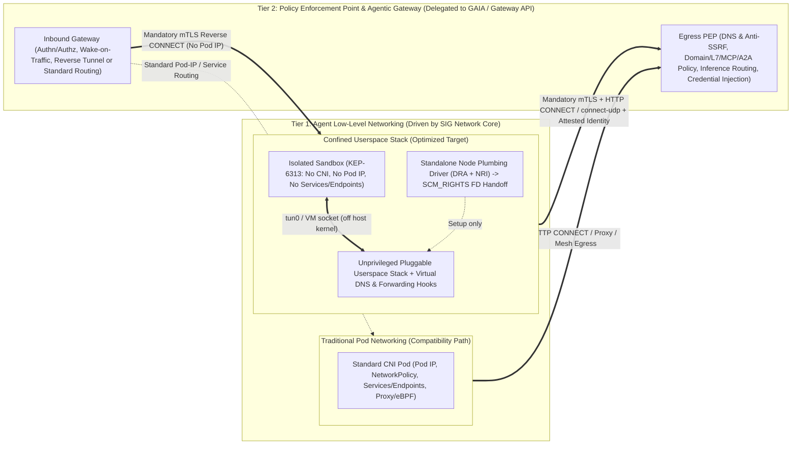

# Kubernetes Networking for the Agentic Era

**Status:** Architecture & Vision Draft  
**Reference Implementation:** [`aojea/agents.net`](https://github.com/aojea/agents.net)  
**Context:** Spin-off of [CNCF Maintainer Summit #126](https://github.com/cncf/maintainer-summit/discussions/126) (*Evolving Kubernetes for Agentic Workloads: Rethinking the Pod and Node Boundary*)

---

## Introduction

Kubernetes needs to evolve for agentic workloads. As we discussed in [CNCF Maintainer Summit #126](https://github.com/cncf/maintainer-summit/discussions/126), autonomous AI agents break many of the assumptions that shaped Kubernetes a decade ago: they sit idle most of their life and burst on wake-up, pack at much higher density than traditional Pods, execute untrusted generated code next to sensitive tools, and expect sub-second lifecycles. Because the traditional Pod contract fights those requirements, dedicated agent platforms such as [Agent Substrate](https://github.com/agent-substrate/substrate) and [NVIDIA OpenShell](https://github.com/NVIDIA/OpenShell) are spinning up alongside or outside Kubernetes, routing around Kubernetes APIs on their hot paths and treating clusters as little more than VM managers. If Kubernetes does not evolve its node and networking boundaries to meet these workloads, the cloud-native ecosystem risks fracturing into proprietary sandbox fabrics.

On the networking side, a clear consensus is already emerging. After several years of experimentation across container runtimes, microVMs, service meshes, and cloud sandboxes, low-level agent networking architectures are settling on a common pattern: removing direct network reachability from the sandbox and tunneling traffic through **HTTP `CONNECT` proxies into Policy Enforcement Points (PEPs)**. This pattern sits on well-established foundations — from early IETF policy enforcement models ([RFC 2753](https://www.rfc-editor.org/info/rfc2753), [RFC 3838](https://www.rfc-editor.org/info/rfc3838/)) and Zero Trust Architecture ([NIST SP 800-207](https://csrc.nist.gov/pubs/sp/800/207/final)), to recent IETF work on agent enforcement boundaries ([`draft-liu-audit-enforcement-points-00`](https://www.ietf.org/archive/id/draft-liu-audit-enforcement-points-00.html)), to production HTTP/2 tunneling in service meshes ([RFC 9110](https://www.rfc-editor.org/info/rfc9110), [RFC 9298](https://www.rfc-editor.org/info/rfc9298), Envoy, and [Istio Ambient HBONE](https://istio.io/latest/docs/ambient/architecture/hbone/)). That convergence gives Kubernetes a major advantage: we can design the interface between low-level sandbox networking and high-level policy enforcement so it stays directly compatible with existing meshes, gateways, and agentic projects.

This work also continues a multi-year progression inside SIG Network. Kubernetes began with the assumption that every Pod gets a cluster-routable IP on a single flat network plumbed by a CNI plugin. After learning through [Multi-Network (KEP-3698)](https://github.com/kubernetes/enhancements/issues/3698) and [KEP-4410](https://github.com/kubernetes/enhancements/issues/4410) how brittle it is to stretch the core network model inside Kubernetes itself, we shifted to composing on top of small, stable core primitives:

- At the **Contributor Summit in Paris (2024)**, we started the **Kubernetes Network Driver** effort to move beyond monolithic CNI assumptions and serial CNI chaining (see [kubernetes#130594](https://github.com/kubernetes/kubernetes/issues/130594)).
- The [Kubernetes Network Driver (KND) model](https://arxiv.org/abs/2506.23628) and [DRANET](https://github.com/kubernetes-sigs/dranet) proved that combining Dynamic Resource Allocation (DRA), [KEP-4817](https://github.com/kubernetes/enhancements/issues/4817) for standard network device status reporting, and [NRI](https://github.com/containerd/nri) lets standalone node drivers attach high-performance NICs and RDMA fabrics for AI/ML workloads without touching the cluster CNI.
- Most recently, [KEP-6313 (`spec.podNetwork: Isolated`)](https://github.com/kubernetes/enhancements/issues/6313) added the confinement primitive: letting a Pod opt out of the default pod network altogether, starting with a loopback-only network namespace, no CNI invocation, and no Pod IP.

Throughout this progression we have followed the same philosophy that built Kubernetes networking: keep core small, define clear interfaces and specifications so the ecosystem can integrate, and ship lean reference implementations alongside them — just as SIG Network has done with `kube-proxy` for Services, `kindnet` for basic Pod networking, [`kube-network-policies`](https://github.com/kubernetes-sigs/kube-network-policies) for `NetworkPolicy` and `ClusterNetworkPolicy`, and [`DRANET`](https://github.com/kubernetes-sigs/dranet) / [`kubernetes-network-drivers`](https://github.com/kubernetes-sigs/kubernetes-network-drivers) for composable node drivers.

Working upstream reference implementations matter just as much as the interfaces. They let SIG contributors iterate quickly against real workloads and give users something concrete to try today. Experience has shown that whenever the SIG stops at paper specifications and moves slower than the surrounding ecosystem, external projects rarely feed design lessons back upstream; instead, basic plumbing gets turned into proprietary differentiation, creating fragmentation or self-declared reference implementations built without consulting the SIG. [`aojea/agents.net`](https://github.com/aojea/agents.net) plays that role here as the lean reference implementation for agentic low-level networking in Kubernetes.

---

## 1. High-Level Architecture: A Two-Tier Model

To keep responsibilities clear and avoid building a monolith, agentic networking in Kubernetes splits cleanly into **two tiers** with distinct ownership inside SIG Network and a standard, mesh-compatible interface between them. This mirrors the separation between **Host Enforcement Points** and **Gateway Enforcement Points** analyzed in [`draft-liu-audit-enforcement-points-00`](https://www.ietf.org/archive/id/draft-liu-audit-enforcement-points-00.html) and the Zero Trust data-plane enforcement model in [NIST SP 800-207](https://csrc.nist.gov/pubs/sp/800/207/final).

### Tier 1 — Agent Low-Level Networking (SIG Network Core)

**SIG Network core** drives the node and Pod boundary. Crucially, Tier 1 must accommodate **two low-level networking paths** into Tier 2 without letting one block the other:

- **The confined userspace network stack (the optimized target):** Built on [KEP-6313](https://github.com/kubernetes/enhancements/issues/6313) (`spec.podNetwork: Isolated`), DRA + NRI plumbing without a CNI dependency, file-descriptor handoff, and an unprivileged pluggable userspace network stack on the host. This path has fundamentally different requirements from classic Kubernetes networking — **no Pod IPs, no IPAM, no `Service` or `EndpointSlice` churn, and no host-kernel TCP/IP exposure** — and must be free to evolve cleanly for high-density, security-critical agent fleets.
- **Traditional Pod networking (the compatibility path):** Less demanding platforms should still be able to run workloads such as [`agent-sandbox`](https://github.com/kubernetes-sigs/agent-sandbox) on existing CNI clusters (using Pod IPs, `NetworkPolicy`, Services, and explicit proxies or CNI/eBPF interception) and connect into the same Tier 2 PEPs and gateways. Supporting traditional Pod networking lowers the bar for adoption today, **without forcing legacy Pod-IP, Service, or IPAM assumptions onto the new confined userspace stack**.

### Tier 2 — Policy Enforcement Points and Agentic Gateways (Delegated to GAIA)

We deliberately **delegate the Policy Enforcement Point (PEP) and L7 gateway layer to GAIA** — the renamed subproject aggregating agentic networking efforts under Gateway API (egress gateways, inference routing, MCP and A2A tool governance, off-sandbox credential injection, auditing, and external inbound routing). Policy languages, L7 inspection, token vaults, and routing rules belong in GAIA and the Gateway API ecosystem, never hardcoded inside the node driver.

### Keeping Both Tiers in Sync

Splitting ownership only succeeds if **SIG Network core (Tier 1) and GAIA (Tier 2) stay tightly in sync**. Tier 1's userspace forwarding hooks, workload identity propagation, and IP-less inbound publication directly feed GAIA, while GAIA's egress and ingress APIs must support both traditional Pod-IP backends and confined, IP-less sandboxes behind userspace stacks.

Anchoring the Tier 1 <-> Tier 2 interface on **standard HTTP `CONNECT` (RFC 9110), optional `connect-udp` (RFC 9298), optional DoH `dns-doh` (RFC 8484), `Proxy-Status` (RFC 9209), and mandatory mTLS** keeps both tiers aligned while staying directly compatible with existing service meshes (such as Envoy and Istio HBONE), standalone proxies, and external agent platforms.

---

## 2. Why Traditional Pod Networking Breaks Down for Agents

Traditional Pod networking remains useful for simpler deployments, which is why Tier 1 keeps a compatibility path for it. However, once platforms push toward dense, multi-tenant, untrusted AI agents — the exact pressures driving [Agent Substrate](https://github.com/agent-substrate/substrate), [OpenShell](https://github.com/NVIDIA/OpenShell), and [CNCF Maintainer Summit #126](https://github.com/cncf/maintainer-summit/discussions/126) — four structural limits of classic CNI networking become hard to patch around:

First, **every `veth` interface exposes the host Linux kernel network stack**. Untrusted agent packets directly exercise host TCP/IP parsing, routing, `conntrack`, and `nf_tables` (for example `CVE-2024-1086`). Mitigating a kernel network bug requires draining and rebooting every node in the fleet — a rollout measured in weeks. As demonstrated at data-center scale by **Snap** ([Marty et al., SOSP 2019](https://dl.acm.org/doi/10.1145/3341301.3359657)), **Arrakis** ([Peter et al., OSDI 2014](https://www.usenix.org/conference/osdi14/technical-sessions/presentation/peter)), and **IX** ([Belay et al., OSDI 2014](https://www.usenix.org/conference/osdi14/technical-sessions/presentation/belay)), separating the privileged OS control plane from a userspace packet-processing dataplane isolates faults and turns network-stack fixes into rapid userspace rollouts rather than kernel reboots.

Second, **IP-per-Pod networking collides with agentic density and lifecycles**. Agent platforms want hundreds of mostly idle sandboxes per node, warm pools that bind dynamically to users, and sub-second suspend/resume ([Agent Substrate](https://github.com/agent-substrate/substrate/blob/main/docs/concepts/architecture.md), [Firecracker, NSDI 2020](https://www.usenix.org/conference/nsdi20/presentation/agache)). Assigning cluster or VPC IPs to every sandbox exhausts IPAM space and churns CNI plugins, eBPF maps, iptables/nftables rules, and `EndpointSlice` objects for workloads that should never sit on a flat cluster network.

Third, **IP-level policy and advisory proxy settings do not match how agents talk to external services**. Modern SaaS APIs, package registries, and LLM providers sit behind shared CDNs whose IPs change constantly, making L3/L4 `NetworkPolicy` brittle and vulnerable to DNS rebinding. Setting `HTTP_PROXY` inside a sandbox is purely advisory; any binary or generated script that ignores environment variables opens a direct socket unless direct routes are removed. And placing API keys or mTLS private keys inside the sandbox means a single prompt injection or remote code execution leaks every credential the agent holds — the exact reason both [Agent Substrate](https://github.com/agent-substrate/substrate/blob/main/docs/guides/egress-traffic.md) and [OpenShell](https://github.com/NVIDIA/OpenShell/blob/main/docs/about/architecture.mdx) enforce default-deny egress and inject credentials strictly outside the sandbox boundary.

Finally, **in-Pod network sidecars carry the wrong trust and maintenance boundary**. Injecting a TUN proxy container into every sandbox Pod adds per-Pod overhead, typically requires `CAP_NET_ADMIN` and `/dev/net/tun` inside the Pod security boundary, and couples tenant Pod specs to network infrastructure upgrades.

---

## 3. Tier 1 in Detail: Low-Level Userspace Networking Without CNI

Inside the optimized Tier 1 path, node-level networking applies two classic systems-security principles: **privilege separation** ([Provos, Friedl, Honeyman, USENIX Security 2003](https://www.usenix.org/conference/12th-usenix-security-symposium/preventing-privilege-escalation)) and **file descriptors as capabilities** ([Capsicum, Watson et al., USENIX Security 2010](https://www.usenix.org/conference/usenixsecurity10/capsicum-practical-capabilities-unix)).

### Standalone Pod Plumbing Without a CNI Dependency

Tier 1 deploys as a standalone Kubernetes Network Driver using DRA (`DRAConsumableCapacity`) for scheduling and claim lifecycle and NRI (`RunPodSandbox`, `CreateContainer`, `StopPodSandbox`, `RemovePodSandbox`) for Pod-scoped runtime plumbing. There is zero CNI dependency:

- With **[KEP-6313](https://github.com/kubernetes/enhancements/issues/6313) (`spec.podNetwork: Isolated`)**, the runtime skips CNI altogether and creates a loopback-only Pod network namespace with no Pod IP and no Service/EndpointSlice participation. The node driver verifies loopback-only isolation and attaches a persistent `tun0` device inside the Pod netns.
- On **existing CNI clusters without KEP-6313**, the same driver operates standalone alongside Cilium, Calico, or other CNIs without replacing or chaining them — either deferring `eth0` isolation to CNI `NetworkPolicy` (preserving return routing for kubelet probes and inbound routers) or blocking `eth0` locally on dev clusters without policy enforcement.

### Privilege Separation Across File Descriptors

Moving packet processing out of the host Linux kernel only reduces the attack surface if the userspace network stack itself runs unprivileged and isolated from host secrets and setup capabilities, mirroring OpenSSH's split between a small privileged monitor and an unprivileged network parser — and Kubernetes's own two-component node pattern (similar to Istio Ambient's split between privileged node plumbing and unprivileged `ztunnel`, while keeping mTLS private keys strictly out of the packet-parsing container):

In Kubernetes, this maps cleanly onto a **two-container DaemonSet Pod** sharing only an in-memory `emptyDir` Unix socket (`AF_UNIX SOCK_SEQPACKET` + `SCM_RIGHTS`), with Pod-level `automountServiceAccountToken: false` and an explicit projected ServiceAccount token mounted exclusively on the plumbing container:

| Component | Privileges & Isolation | Network Visibility | Access to Secrets / Host State | Parses Raw Sandbox Packets? |
| --- | --- | --- | --- | --- |
| **Sandbox Pod** | Non-root, `capabilities.drop: ["ALL"]`, no sidecar | `lo` + `tun0` only (no direct route out) | None (optional public CA cert only) | Generates them |
| **Userspace Stack Container (`agents-net-stack`)** | Separate container (`65534:65534`), **0 capabilities**, `readOnlyRootFilesystem`, own cgroup/memory limit, `PR_SET_NO_NEW_PRIVS`, `AF_UNIX`-only seccomp-BPF (`TSYNC`, denies `AF_INET`/`AF_INET6`/`AF_NETLINK`/`AF_PACKET`) | None — only the passed `tunFD` and `brokerFD` over `emptyDir` socket | **None** (zero K8s SA token, zero mTLS keys, zero `/var/run/netns` or `/var/run/nri` mounts) | **Yes** (isolated here) |
| **Node Plumbing Container (`dra-agents-net`)** | Setup-time plumbing caps (DRA, NRI, `tun0` creation; zero cluster `Secret` RBAC) | Host network to PEP / API / optional ingress bridge | Workload mTLS identity (SPIFFE, KEP-4317 `PodCertificate`, X.509) | **No** (closes `tunFD` right after `SCM_RIGHTS`) |
| **Tier 2 PEP / GAIA** | Dedicated off-host gateway | Egress VPC / Internet / Ingress edge | Upstream API credentials, optional inspection CA key | Only authenticated HTTP `CONNECT` / L7 streams |

Setup privileges remain strictly on the plumbing container and are never exposed to the sandboxed agent or reachable by the packet parser. Because `tun0` is created with `TUNSETPERSIST`, crashing, OOM-killing, or upgrading the userspace stack container lets the plumbing container reconnect and re-attach live sandboxes automatically without tearing down Pods or rebooting host kernels. Longer term, delegating virtual interface creation to the container runtime (for example via OCI `linux.netDevices` or a future CRI/NRI descriptor handoff) can narrow plumbing privileges further while staying independent of CNI.

### Pod Networking Hooks: Virtual DNS, PEP Forwarding, and Inbound Delivery

Because an isolated sandbox has no direct external IP route, Tier 1 provides three concrete hooks that connect unmodified applications to Tier 2 (GAIA / PEPs):

- **Virtual DNS hook (pluggable across Synthetic, Unified PEP DoH, and Separate DNS PEP):** The node driver points `/etc/resolv.conf` at a local resolver address terminated inside the userspace stack, mapping positive answers to deterministic synthetic addresses drawn from dedicated non-overlapping ranges ([RFC 2544](https://www.rfc-editor.org/info/rfc2544) `198.18.0.0/15` for IPv4 and [RFC 6666](https://www.rfc-editor.org/info/rfc6666) `100::/64` for IPv6) and tracking the per-sandbox `(synthetic IP -> hostname)` binding. Connections to unmapped synthetic addresses fail closed locally so synthetic IPs never leak upstream or collide with real IPs, while literal IPs outside the synthetic pool pass through as literals. The Virtual DNS hook supports three explicit resolution modes without forcing split-brain policy or breaking existing HTTP `CONNECT` proxies:
  1. *Local Synthetic (`resolve-all`, default):* Strips `search`/`ndots` from `/etc/resolv.conf` and answers `A`/`AAAA` locally with zero RTT and zero DNS exfiltration channel, working out of the box with any vanilla HTTP `CONNECT` proxy or mesh.
  2. *Unified PEP DoH ([RFC 8484](https://www.rfc-editor.org/info/rfc8484), PEP capability `dns-doh`):* Forwards `POST /dns-query` over the sandbox's existing brokered channel and the **same mTLS HTTP/2 PEP session** used for `CONNECT`/`connect-udp`. One policy engine enforces the allowlist on both DNS and traffic (returning `NXDOMAIN` for disallowed or non-existent names so Kubernetes `search` lists, `ndots:5`, short Service names, and client retries work natively), while Virtual DNS still rewrites positive answers into `198.18.0.0/15` / `100::/64` so real IPs never leak into the sandbox.
  3. *Separate DNS PEP (opt-in):* Routes the same RFC 8484 DoH hook to a dedicated policy-enforcing DNS endpoint (such as a DoH-enabled CoreDNS or DNS firewall) when an operator pairs an existing `CONNECT`-only Traffic PEP with an independent DNS layer.
- **PEP forwarding / redirection hook:** When the userspace stack terminates a TCP connection or UDP flow from `tun0`, the forwarding hook recovers the target hostname from the Virtual DNS hook (or preserves a literal IP) and frames the flow as [RFC 9110](https://www.rfc-editor.org/info/rfc9110) `CONNECT host:port` or [RFC 9298](https://www.rfc-editor.org/info/rfc9298) `connect-udp` (carrying [RFC 9297](https://www.rfc-editor.org/info/rfc9297) capsules over [RFC 8441](https://www.rfc-editor.org/info/rfc8441) extended CONNECT) over the sandbox's egress file descriptor. The node identity layer strips any guest-supplied identity headers, attaches platform-attested workload identity (mTLS client cert SAN / SPIFFE ID and structured attributes), and forwards over mandatory mTLS to Tier 2. Non-2xx policy refusals carrying [RFC 9209](https://www.rfc-editor.org/info/rfc9209) `Proxy-Status` fail the guest socket closed immediately.
- **Inbound traffic delivery without Pod IPs:** For sandboxes exposing authorized ports without a Pod IP, Tier 1 publishes non-IP inbound metadata (node bridge endpoint, mTLS server identity, immutable sandbox ID + generation, and pinned ports) and accepts mandatory mTLS `CONNECT <sandbox-id>:<port>` reverse tunnels from Tier 2 gateways, delivering streams locally into the sandbox (`socketat` for containers, `vsock` for microVMs). Stopping a sandbox revokes both active tunnels and published endpoints immediately.

### Bring Your Own Userspace Stack (BYOS), Tenancy Models, and KEP-5972

Because the plumbing container communicates with the dataplane stack through a minimal file-descriptor handoff over a Unix `SOCK_SEQPACKET` control socket (`add` with `[tunFD, brokerFD]`, `remove`), Tier 1 keeps the default lean while leaving room for multiple stacks and isolation models:

- **Shared per-node stack as the clean default:** Following the proven single-stack-per-host model of **Snap** ([SOSP 2019](https://dl.acm.org/doi/10.1145/3341301.3359657)) and Istio Ambient `ztunnel`, running one shared, memory-safe unprivileged stack container (`agents-net-stack`, built on Go `gVisor netstack`) per node gives strong isolation from the host kernel and node privileges at the lowest memory overhead and sub-millisecond attach latency.
- **Room for multi-single-tenant stacks and KEP-5972 Dynamic Containers:** Environments that require hard per-tenant or per-sandbox stack isolation can build on the exact same `emptyDir` Unix socket contract without changing DRA, NRI, or Pod manifests — either via dedicated per-tenant/per-class stack containers, child-process `per-pod` workers (`CLONE_NEWNET`), or **[KEP-5972 (Dynamic Containers)](https://github.com/kubernetes/enhancements/blob/master/keps/sig-node/5972-dynamic-containers/README.md)**. KEP-5972 converges on both sides of the design:
  - *DaemonSet side:* Dynamically add per-tenant stack containers (each with its own cgroup, UID, image, and socket subpath) or run zero-downtime blue-green in-place stack upgrades by handing persistent `tun0` descriptors to the new stack container before removing the old one.
  - *Workload side:* In pre-warmed agentic Pods that dynamically add and remove ephemeral tool containers via `/dynamic`, `HostTun` + NRI `CreateContainer` attaches confined networking automatically to every new container with zero Pod-creation webhook or sidecar mutation.
- **Pluggable stacks:** Go (`gVisor netstack`) ships as the memory-safe built-in default container image, while Rust stacks (`smoltcp`, Fuchsia `Netstack3`), C stacks (`lwIP`), or microVM transports (`virtio-net`, `vhost-user`, `vsock`) can drop into the stack container slot behind the same Unix socket + `SCM_RIGHTS` boundary.

---

## 4. Tier 2 Delegation and Ecosystem Compatibility

Delegating Tier 2 to **GAIA** while grounding the Tier 1 <-> Tier 2 interface on standard mTLS HTTP `CONNECT` / `connect-udp` — and keeping traditional Pod networking working alongside the new userspace stack — lets Kubernetes integrate cleanly with both existing infrastructure and dedicated agent platforms:

- **GAIA (Gateway API):** GAIA aggregates the agentic networking work under Gateway API — egress gateways, inference routing, MCP and A2A tool governance, token injection, and SPIFFE-based agent identity. Tier 2 gateways can serve traditional CNI Pods today while also consuming Tier 1's mandatory mTLS `CONNECT` / `connect-udp` egress streams and IP-less reverse-tunnel ingress metadata (for example projected into Gateway API backend primitives with `BackendTLSPolicy`) without requiring Pod IPs, `Service` objects, or `EndpointSlice` churn for isolated sandboxes.
- **Existing Service Meshes and PEPs:** Because the low-to-high interface uses standard HTTP `CONNECT` / `connect-udp` over mTLS — the same tunnel substrate already terminated by Envoy, [Istio Ambient HBONE](https://istio.io/latest/docs/ambient/architecture/hbone/), and cloud Secure Web Gateways — existing meshes and proxies can act as Tier 2 PEPs without custom node drivers.
- **SIG Apps [`agent-sandbox`](https://github.com/kubernetes-sigs/agent-sandbox):** `Sandbox`, `SandboxWarmPool`, and `SandboxClaim` workloads work on traditional Pod networking for simpler clusters, and opt seamlessly into Tier 1's confined userspace stack via standard `podTemplate.spec.resourceClaims` with zero CRD changes; warm pools start confined immediately and rebind attested identity on adoption.
- **Agent Substrate, OpenShell, and MicroVM Runtimes:** [Agent Substrate](https://github.com/agent-substrate/substrate) (default-deny actor networking, `atenet-egress` PEP with zero in-sandbox credentials, and `atenet-router` reverse `CONNECT` + wake-on-traffic over gVisor/Cloud Hypervisor/Kata) and [NVIDIA OpenShell](https://github.com/NVIDIA/OpenShell) (outer deny-by-default fence, mediated HTTP/2 channel to a trusted supervisor, DNS/TCP mediation, and credential brokering) both rely on the same fundamental split. Standardizing the Tier 1 <-> Tier 2 boundary lets Kubernetes host these runtimes natively instead of forcing each platform to build a bespoke networking fabric.

---

## 5. Reference Implementation (`aojea/agents.net`) and Open Sync Points

[`aojea/agents.net`](https://github.com/aojea/agents.net) serves as the lean, standalone SIG Network reference implementation for Tier 1. It implements the DRA (`DRAConsumableCapacity`) + NRI node driver (`dra-agents-net`), default `HostTun` mode with two-container privilege separation (`dra-agents-net` + unprivileged `agents-net-stack` over an `emptyDir` `SCM_RIGHTS` socket with `AF_UNIX`-only seccomp-BPF and automatic crash recovery over persistent `tun0`, plus optional child-process `per-pod` isolation), Virtual DNS (`198.18.0.0/15` and `100::/64`), mandatory mTLS egress forwarding (`MTLS`, `SPIFFE`, `PodCertificate`), opt-in mTLS IP-less ingress, and an end-to-end integration demo with `agent-sandbox`.

Next milestones focus on refining the Virtual DNS and PEP forwarding hook interfaces, validating end-to-end compatibility with **GAIA** and existing meshes, and testing alternative userspace stack container images such as Rust `smoltcp` behind the same Unix socket boundary.

### Open Sync Points Between SIG Network Core and GAIA

1. **Dual-mode ingress in GAIA / Gateway API:** How should Gateway API represent `spec.podNetwork: Isolated` sandboxes for reverse-tunnel delivery over mTLS HTTP/2 `CONNECT` (compatible with HBONE/Envoy) alongside traditional Pod-IP backends, without imposing `Service` / `EndpointSlice` / IPAM requirements on the new userspace stack?
2. **Shared workload identity contract:** How should node-attested identity (SPIFFE X.509-SVID, KEP-4317 `PodCertificate`, and structured attributes) be standardized across Tier 1 drivers, GAIA policies, and existing meshes?
3. **Runtime delegation without CNI:** Can container runtimes (via CRI/NRI or OCI `linux.netDevices`) create and attach the sandbox interface and pass its file descriptor to the Tier 1 driver, removing `setns` from the node DaemonSet without introducing a CNI dependency?
4. **Minimal BYOS worker boundary:** What is the smallest useful contract between a node plumbing driver and an unprivileged userspace stack (FD handoff, Virtual DNS hook, PEP forwarding hook, and revocation) that allows multiple stacks to plug in cleanly?

---

## References

### Policy Enforcement, Zero Trust, and Agent Auditing
- **RFC 2753** — R. Yavatkar, D. Pendarakis, R. Guerin, *A Framework for Policy-based Admission Control*, IETF, January 2000. https://www.rfc-editor.org/info/rfc2753
- **RFC 3838** — A. Barbir, O. Batuner, A. Beck, T. Chan, H. Orman, *Policy, Authorization, and Enforcement Requirements of the Open Pluggable Edge Services (OPES)*, IETF, August 2004. https://www.rfc-editor.org/info/rfc3838/
- **NIST SP 800-207** — S. Rose, O. Borchert, S. Mitchell, S. Connelly, *Zero Trust Architecture*, NIST, August 2020. https://csrc.nist.gov/pubs/sp/800/207/final
- **IETF Internet-Draft** — C. P. Liu, Y. Ni, *Enforcement Points for Agents* (`draft-liu-audit-enforcement-points-00`), IETF, 2026. https://www.ietf.org/archive/id/draft-liu-audit-enforcement-points-00.html

### HTTP Tunneling, Proxying, and Addressing Standards
- **RFC 9110** — R. Fielding, M. Nottingham, J. Reschke, *HTTP Semantics* (`CONNECT`), IETF, June 2022. https://www.rfc-editor.org/info/rfc9110
- **RFC 8441** — P. McManus, *Bootstrapping WebSockets with HTTP/2* (Extended `CONNECT`), IETF, September 2018. https://www.rfc-editor.org/info/rfc8441
- **RFC 9297 / RFC 9298** — D. Schinazi, L. Pardue, *HTTP Datagrams and the Capsule Protocol* / *Proxying UDP in HTTP (`connect-udp`)*, IETF, August 2022. https://www.rfc-editor.org/info/rfc9298
- **RFC 8484** — P. Hoffman, P. McManus, *DNS Queries over HTTPS (DoH)*, IETF, October 2018. https://www.rfc-editor.org/info/rfc8484
- **RFC 9209** — M. Nottingham, P. Sikora, *The Proxy-Status HTTP Response Header Field*, IETF, June 2022. https://www.rfc-editor.org/info/rfc9209
- **RFC 2544 / RFC 6666** — Dedicated non-overlapping benchmark/discard address blocks (`198.18.0.0/15`, `100::/64`). https://www.rfc-editor.org/info/rfc2544, https://www.rfc-editor.org/info/rfc6666

### Userspace Networking, Privilege Separation, and Sandboxing Literature
- **OpenSSH Privilege Separation** — N. Provos, M. Friedl, P. Honeyman, *Preventing Privilege Escalation*, USENIX Security 2003. https://www.usenix.org/conference/12th-usenix-security-symposium/preventing-privilege-escalation
- **Capsicum** — R. N. M. Watson, J. Anderson, B. Laurie, K. Kennaway, *Capsicum: Practical Capabilities for UNIX*, USENIX Security 2010. https://www.usenix.org/conference/usenixsecurity10/capsicum-practical-capabilities-unix
- **Arrakis** — S. Peter et al., *Arrakis: The Operating System is the Control Plane*, USENIX OSDI 2014. https://www.usenix.org/conference/osdi14/technical-sessions/presentation/peter
- **IX** — A. Belay et al., *IX: A Protected Dataplane Operating System for High Throughput and Low Latency*, USENIX OSDI 2014. https://www.usenix.org/conference/osdi14/technical-sessions/presentation/belay
- **Snap** — M. Marty et al., *Snap: a Microkernel Approach to Host Networking*, ACM SOSP 2019. https://dl.acm.org/doi/10.1145/3341301.3359657
- **Firecracker** — A. Agache et al., *Firecracker: Lightweight Virtualization for Serverless Applications*, USENIX NSDI 2020. https://www.usenix.org/conference/nsdi20/presentation/agache
- **Kubernetes Network Driver Model** — A. Ojea et al., *The Kubernetes Network Driver Model: A Composable Architecture for High-Performance Networking*, IEEE LCN 2025 (`arXiv:2506.23628`). https://arxiv.org/abs/2506.23628

### Kubernetes, Service Mesh, and Agentic Ecosystem Projects
- **CNCF Maintainer Summit #126** — *Evolving Kubernetes for Agentic Workloads: Rethinking the Pod and Node Boundary*. https://github.com/cncf/maintainer-summit/discussions/126
- **KEP-6313** — *Network-Isolated Pod Sandboxes (`spec.podNetwork: Isolated`)*. https://github.com/kubernetes/enhancements/issues/6313
- **KEP-5972** — *Dynamic Containers*. https://github.com/kubernetes/enhancements/blob/master/keps/sig-node/5972-dynamic-containers/README.md
- **KEP-4817** — *Resource Claim Status for Network Devices*. https://github.com/kubernetes/enhancements/issues/4817
- **KEP-4317** — *Pod Certificates*. https://github.com/kubernetes/enhancements/issues/4317
- **DRANET & Kubernetes Network Drivers** — https://github.com/kubernetes-sigs/dranet, https://github.com/kubernetes-sigs/kubernetes-network-drivers
- **Kubernetes `agent-sandbox`** — https://github.com/kubernetes-sigs/agent-sandbox
- **Istio Ambient Mesh HBONE** — https://istio.io/latest/docs/ambient/architecture/hbone/
- **Agent Substrate** — *Architecture & Egress Traffic Guides*. https://github.com/agent-substrate/substrate
- **NVIDIA OpenShell** — *Architecture & Sandboxed Supervision*. https://github.com/NVIDIA/OpenShell
